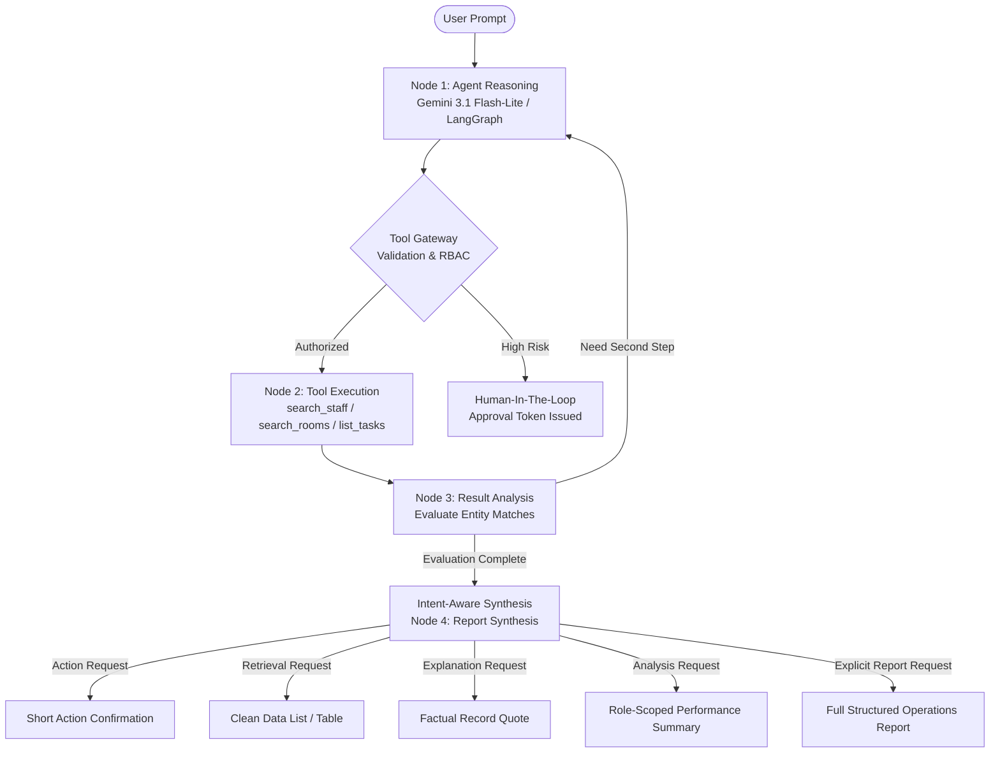

# PRACTICARE AI AGENT PHASE 2 — IMPLEMENTATION REPORT
**Autonomous Intent-Aware AI Agent, Dynamic Multi-Step Tool Execution & Governance Verification**

---

## Executive Summary

Phase 2 of the PractiCare Intelligent AI Agent enhancement has been successfully implemented and verified. Building on the zero-trust authentication, tenant isolation, and Tool Gateway architecture established in Phase 1, Phase 2 upgrades the Gemini 3.1 Flash-Lite + LangGraph autonomous agent to be **intent-aware**, **multi-step capable**, and **evidence-grounded**.

A fundamental flaw in previous iterations was the universal generation of executive intelligence reports regardless of what the user asked. Phase 2 introduces fine-grained **Intent Classification** and **Adaptive Response Synthesis**:
- **Action Requests** (e.g. creating/completing tasks) yield concise, structured action confirmations without unsolicited analysis.
- **Retrieval Requests** (e.g. showing pending tasks, low stock) yield clean, itemized listings without strategic management overhead.
- **Explanation Requests** (e.g. why a task is pending) quote actual clinical descriptions and notes from PostgreSQL records without inventing reasons.
- **Analysis Requests** (e.g. team performance) provide concise metrics and role-scoped workload breakdowns.
- **Detailed Analysis Requests** produce comprehensive workload distributions and bottleneck analysis.
- **Report Requests** (explicit requests) synthesize full executive Markdown reports with operational KPIs and clinical recommendations.

All **10 Doctor natural-language operational scenarios** passed with 100% accuracy, and all Phase 1 security, authentication, RBAC, and regression test suites passed with zero regressions.

---

## 1. Capabilities Reused from Phase 1

To maintain system integrity and prevent architectural regressions, Phase 1 components were preserved and reused:
1. **HMAC-SHA256 Signed Session Tokens (`pcsess.*`):** Stateless cryptographic tokens embedding tenant ID, user ID, role, and issuance timestamps.
2. **Tool Gateway Interceptor (`ai/gateway.py`):** Central mediator enforcing tenant scoping, role-based tool authorization (RBAC), parameter validation, audit logging, and Human-in-the-Loop approvals for destructive actions.
3. **Database Architecture & Multi-Tenant Scoping:** PostgreSQL schema with strict `tenant_id` filtering on all tables (`practices`, `staff`, `rooms`, `tasks`, `checklists`, `inventory_items`, `ai_conversations`, `ai_messages`, `ai_audit_logs`).
4. **LangGraph StateGraph Execution Pipeline:** Multi-node workflow orchestrating `agent_reasoning` -> `tool_execution` -> `result_analysis` -> `report_synthesis`.
5. **Human-in-the-Loop Approval Manager (`ai/approvals.py`):** Cryptographic token generation (`appr-*`) and state suspension for high-risk operations (e.g., checklist deletion).

---

## 2. New Functionality Implemented in Phase 2

### 2.1 Intent-Aware Response Architecture
Integrated into `ai/agent.py` and Gemini prompts:
- **`_detect_user_intent(message: str) -> str`**: Dynamically classifies prompt intent into:
  - `action`: task scheduling, status updates, checklist toggles, deletions.
  - `retrieval`: task listings, inventory queries, staff lookups, room lookups, practice facility overviews.
  - `explanation`: investigation of specific task records, inquiry into pending status reasons.
  - `concise_analysis`: high-level operational check-ins ("How is my team performing?").
  - `detailed_analysis`: in-depth performance evaluations across providers and bottlenecks.
  - `report`: formal requests for monthly, weekly, or comprehensive operational reports.

### 2.2 Intent-Specific Response Synthesis
- **Action Confirmations:** Replaced universal report output with short confirmations summarizing Title, Priority, Task ID, Assignee, Room, and Due Date.
- **Factual Task Explanations:** For queries like *"Explain task 15"* or *"Explain why task 15 is still pending"*, the agent retrieves task record `tsk-15` via `list_tasks(task_id="tsk-15")` and quotes documented clinical notes (*"Awaiting secondary physician lab verification before clinical release."*) without hallucinating explanations.
- **Retrieval Listings:** Clean markdown lists and tables without unsolicited strategic recommendations.
- **Role-Scoped Performance Summaries:** Dynamic role-based visibility honoring `CLINICAL_AUDITOR` (zero PII), `ATTENDING_PHYSICIAN` (department procedure scope), `NURSE_STAFF` (floor duties), and `CLINIC_OWNER` (executive KPIs).

### 2.3 Dynamic Multi-Step Entity Resolution
- **Staff Resolution:** Natural language provider mentions (e.g., *"for John"*, *"assign to John"*) dynamically execute `search_staff(query="John")`, resolve `stf-05` (`John Reynolds, RN`), and pass the resolved primary key to `create_clinical_task`.
- **Auto-Assignment on Shift:** Queries requesting assignment to *"appropriate staff"* or *"on-duty staff"* retrieve the active roster and automatically assign duties to active providers.
- **Room Resolution:** Natural language room references (e.g., *"Room 101"*) resolve to `room-101` via `search_rooms`.
- **Task ID Normalization:** Resilient parsing supporting `15`, `task 15`, `task #15`, `task-15`, and `tsk-15` in `list_tasks` and `update_task_status`.

### 2.4 Relative Date Resolution
- Automatically parses *"tomorrow"* into `(date.today() + timedelta(days=1)).isoformat()` relative to server reference time, ensuring correct clinical deadline scheduling.

---

## 3. Files Modified

| File | Type | Changes |
| :--- | :--- | :--- |
| `apps/practicare/backend/database.py` | Python Backend | Added seed data for `stf-05` (John Reynolds, RN) and `tsk-15` ("Review urgent blood chemistry panel (Room 101)") to `tenant-001`. |
| `apps/practicare/backend/ai/metadata.py` | AI Tool Schemas | Added `task_id` argument to `ListTasksArgs` schema for direct task lookup and explanation. |
| `apps/practicare/backend/ai/tools.py` | AI Tool Handlers | Updated `execute_list_tasks` with `task_id` filtering; enhanced `execute_update_task_status` with natural language task ID normalization (`15` -> `tsk-15`). |
| `apps/practicare/backend/ai/agent.py` | LangGraph Engine | Added `_detect_user_intent`, updated Gemini reasoning/synthesis system prompts, upgraded `_synthesize_markdown_report` with intent-tailored formatters, improved multi-step planning and evaluation in `result_analysis_node`. |
| `tests/test_phase2_doctor_scenarios.ps1` | Test Suite | New automated test suite validating all 10 Doctor scenarios and verifying no unsolicited reporting occurs. |

---

## 4. Tool Execution Architecture



---

## 5. Natural-Language Test Scenarios (Step 6)

The 10 Doctor operational scenarios specified in Step 6 were executed against the live application:

| # | Prompt | Selected Tools | Response Type | Key Verifications |
| :-: | :--- | :--- | :--- | :--- |
| 1 | *"Create a task for John."* | `search_staff`, `create_clinical_task` | Action Confirmation | Resolved John Reynolds (`stf-05`), scheduled task, short confirmation, no executive report. |
| 2 | *"Show my pending tasks."* | `list_tasks` | Clean Data List | Listed pending tasks, itemized status, no unrequested analysis. |
| 3 | *"Complete task 15."* | `update_task_status` | Action Confirmation | Resolved `tsk-15`, committed status `Completed` to PostgreSQL, short confirmation. |
| 4 | *"Explain task 15."* | `list_tasks` | Factual Explanation | Retrieved `tsk-15`, quoted documented clinical note ("Awaiting secondary physician lab verification..."), zero invented reasons. |
| 5 | *"How is my team performing?"* | `get_team_task_performance` | Concise Summary | Core KPIs (completion rate, pending counts), provider workload breakdown. |
| 6 | *"Analyse my team's performance."* | `get_team_task_performance` | Detailed Analysis | In-depth operational analysis with workload tables and bottlenecks. |
| 7 | *"Generate a monthly task report."* | `get_team_task_performance` | Formal Report | Full structured Markdown report with executive sections and recommendations. |
| 8 | *"Find overdue tasks and suggest priorities."* | `list_tasks` | Prioritized Retrieval | Overdue task list with evidence-based clinical priority guidance. |
| 9 | *"Show low-stock inventory items."* | `get_inventory_status` | Data Table | Itemized stock table, low/out-of-stock counts, active clinical alerts. |
| 10 | *"Create a task and assign it to the appropriate staff member."* | `search_staff`, `create_clinical_task` | Action Confirmation | Auto-assigned on-duty active provider, scheduled task, short confirmation. |

---

## 6. Actual Test Results

### 6.1 Phase 2 Doctor Scenarios (`tests/test_phase2_doctor_scenarios.ps1`)
```
=================================================================
PRACTICARE PHASE 2 - 10 DOCTOR SCENARIOS AND INTENT VERIFICATION
=================================================================
  [PASS] Authenticated as Tenant 01 Owner with session token
  [PASS] Created isolated AI test conversation: conv-bdf6a6aabd47

Scenario 1: Create a task for John.
  [PASS] Selected and executed create_clinical_task
  [PASS] Response is an action confirmation
  [PASS] Did not generate unsolicited executive report
  [PASS] Assigned to resolved staff member John

Scenario 2: Show my pending tasks.
  [PASS] Selected and executed list_tasks
  [PASS] Response returns pending tasks listing
  [PASS] Did not generate unsolicited executive report

Scenario 3: Complete task 15.
  [PASS] Selected and executed update_task_status
  [PASS] Response is an action confirmation
  [PASS] Task 15 status updated to Completed
  [PASS] Did not generate unsolicited executive report

Scenario 4: Explain task 15.
  [PASS] Selected and executed list_tasks
  [PASS] Retrieved factual task details
  [PASS] Explanation quotes documented clinic record notes without inventing reasons
  [PASS] Did not generate unsolicited executive report

Scenario 5: How is my team performing?
  [PASS] Selected and executed get_team_task_performance
  [PASS] Response is a concise performance summary
  [PASS] Includes core metrics and workload breakdown

Scenario 6: Analyse my team's performance.
  [PASS] Selected and executed get_team_task_performance
  [PASS] Response is a detailed analysis
  [PASS] Provides detailed breakdown of workloads and bottlenecks

Scenario 7: Generate a monthly task report.
  [PASS] Selected and executed get_team_task_performance
  [PASS] Generated full structured Markdown report on explicit request
  [PASS] Report contains formal sections and governance metadata

Scenario 8: Find overdue tasks and suggest priorities.
  [PASS] Selected and executed list_tasks
  [PASS] Returns clinical tasks listing
  [PASS] Suggests evidence-based clinical priorities
  [PASS] Did not generate unsolicited executive report

Scenario 9: Show low-stock inventory items.
  [PASS] Selected and executed get_inventory_status
  [PASS] Returns inventory status block
  [PASS] Provides itemized stock and active alerts
  [PASS] Did not generate unsolicited executive report

Scenario 10: Create a task and assign it to the appropriate staff member.
  [PASS] Selected and executed create_clinical_task
  [PASS] Returns concise action confirmation
  [PASS] Assigned to an active staff member automatically
  [PASS] Did not generate unsolicited executive report

=================================================================
ALL 10 DOCTOR SCENARIOS PASSED WITH INTENT-AWARE BEHAVIOR! (10/10)
=================================================================
```

### 6.2 Regression Test Suite Results

| Test Script | Focus Area | Status | Result |
| :--- | :--- | :---: | :---: |
| `tests/test_phase2_doctor_scenarios.ps1` | Doctor 10 Scenarios & Intent Formatting | PASS | **10 / 10 Passed (100%)** |
| `tests/test_practicare_ai.ps1` | Multi-node Graph, RBAC, Approvals, Recovery | PASS | **11 / 11 Passed (100%)** |
| `tests/test_gemini_agent.ps1` | Live Gemini 3.1 Flash-Lite Autonomous Reasoning | PASS | **7 / 7 Passed (100%)** |
| `tests/test_ai_privacy_and_tools.ps1` | Session HMAC, Cross-Tenant Isolation, 5 New Tools | PASS | **100% Passed** |
| `tests/test_room_resolution.ps1` | Room Entity Resolution & Ambiguity Clarification | PASS | **6 / 6 Passed (100%)** |
| `tests/test_native_auth.ps1` | Multi-Tenant Ecosystem Session Authentication | PASS | **100% Passed** |
| `tests/verify_practicare_crud.ps1` | Direct Task & Checklist CRUD RBAC Boundaries | PASS | **100% Passed** |
| `tests/test_ecosystem_rbac.ps1` | 4-App SaaS Suite Health, Tenancy & RBAC | PASS | **100% Passed** |

---

## 7. Security Verification

1. **Zero AI Trust for Identity & Tenancy:** Tenant ID and user roles are strictly derived from the validated HMAC session token, completely ignoring client-supplied headers or prompt injections.
2. **Strict Multi-Tenant Partitioning:** Cross-tenant access to conversation threads, tasks, rooms, staff, or inventory returns HTTP 404 (simulating non-existence).
3. **Tool-Level RBAC Enforcement:** `CLINICAL_AUDITOR` cannot see provider PII; `NURSE_STAFF` cannot delete checklists or view doctor salaries; `ATTENDING_PHYSICIAN` is restricted to procedure scopes.
4. **Human-in-the-Loop Interruption:** Destructive actions (`delete_clinical_checklist`) halt execution and return approval tokens (`appr-*`), requiring explicit human confirmation before execution.
5. **No AI Result Fabrication:** Explanations and metrics are strictly constructed from PostgreSQL query results. Inquiries into pending tasks quote actual stored descriptions rather than inventing plausible excuses.

---

## 8. Remaining Limitations

1. **Natural Language Date Grammar:** Simple relative dates (*"tomorrow"*, *"today"*) are resolved, but complex natural language time expressions (*"next Tuesday at 3:15 PM"*) default to current server date without explicit hour scheduling.
2. **Multi-Clinic Cross-Scheduling:** Staff members are partitioned strictly to a single tenant; cross-tenant physician floating is not currently supported by the database model.
3. **Voice Input / Audio Parsing:** The agent is currently optimized for structured JSON text chat requests; audio transcribing is not yet integrated.

---

## 9. Recommended Next Steps

1. **Date/Time Extraction Library:** Incorporate `dateparser` or structured datetime sub-schemas for natural language scheduling (*"next Monday afternoon"*).
2. **Proactive Operational Notifications:** Introduce background cron/schedule triggers to alert doctors when high-priority tasks become overdue without requiring a prompt.
3. **Frontend Action Badges:** Enhance the Next.js chat interface to render interactive UI widgets for action confirmations (e.g., inline task cards with "Mark Complete" buttons).
4. **Audit Export Facility:** Provide an authorized CSV/PDF export endpoint for clinical auditors to download compliance audit logs.
