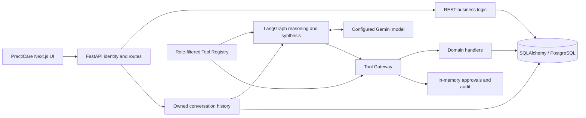

# PractiCare Codex Implementation Plan

**Audit date:** 2026-10-16  
**Status:** Audit complete; implementation NOT started. Approval required before implementation.  
**Scope:** PractiCare only. Preserve Next.js, FastAPI, PostgreSQL, Gemini, LangGraph, Tool Registry, Tool Gateway, RBAC, and tenant isolation. No MCP implementation or dependencies.

## Audit Basis and Limits

- Read the complete doctor's [requirements DOCX](<./Pracyicare requirement lists.docx>) by extracting its document XML in memory, and the complete [preliminary gap analysis](./PRACTICARE_INTELLIGENT_AI_GAP_ANALYSIS.md). Neither exists at the requested `docs/` path; the root copies are the actual available inputs. The attached implementation brief was also read; the user's latest audit-only instruction takes precedence over its older instruction to implement Phase 1.
- Inspected PractiCare frontend, backend routes/schemas/models, authentication, database initialization, AI graph/registry/gateway/handlers/approvals, Compose/Dockerfiles, and relevant test source. Existing reports were not accepted as runtime evidence.
- **Implemented** below means supported by inspected source, not demonstrated against a running deployment. **Partial** means useful code exists but the complete requirement is missing or defective. **Missing** means no implementation was found in the relevant source, schema, routes, registry, or frontend.
- No application imports, services, containers, databases, migrations, live Gemini calls, or integration tests were run. No database files, archives of application/data snapshots, actual environment files, or production/patient records were inspected. No credentials are reproduced here.
- Much of the workspace, including the application tree, was already untracked in Git. This audit preserves that state and adds only this document. Installed versions, applied schema state, provider availability, and historical test success remain unverified.

## 1. Current Architecture

### 1.1 Actual Components

| Layer | Source-verified architecture | Implication |
| --- | --- | --- |
| Frontend | [package.json](./apps/practicare/frontend/package.json) declares Next.js **16.4.0**, React **19.3.0**, TypeScript, Tailwind, and Lucide. [page.tsx](./apps/practicare/frontend/src/app/page.tsx) is a large client-side screen containing dashboard, tasks, checklists, inventory, rooms, staff, authentication, company administration, and AI chat. | Not Next.js 14. Six main tabs, not a complete medical-office module suite. Current declared dependencies were not installed or built during audit. |
| API | [main.py](./apps/practicare/backend/main.py) defines FastAPI routes, authorization dependencies, CRUD, company membership, conversations, chat, and approvals. [schemas.py](./apps/practicare/backend/schemas.py) supplies Pydantic contracts. | Business logic is split between REST route bodies and AI handlers; there is no consistent shared domain-service layer yet. |
| Persistence | [models.py](./apps/practicare/backend/models.py) has **11 models**: Practice, Staff, Room, Task, Checklist, InventoryItem, User, StaffInvitation, AIConversation, AIMessage, StaffLeave. SQLAlchemy sessions come from [database.py](./apps/practicare/backend/database.py). | Tenant columns and scoped queries exist, but neither complete relational tenant constraints nor database row-level security are defined in inspected source. |
| Schema lifecycle | FastAPI lifespan calls `init_db_and_seed`; it runs `create_all`, inline PostgreSQL column additions/backfills, and demo seeding. No versioned migration directory or Alembic configuration was found. | Starting the backend is a database-writing action. Existing Python models do not establish what schema is actually deployed. |
| AI | [agent.py](./apps/practicare/backend/ai/agent.py) uses Gemini through LangChain and a compiled LangGraph StateGraph: reasoning -> tool execution -> result analysis -> synthesis, with conditional loops. Defaults: Gemini mode, `gemini-3.1-flash-lite`, three iterations, nominal five-tool limit. | Preserve this graph and provider. Improve planning and execution semantics; do not replace them with MCP or direct LLM SQL. |
| Tool boundary | [registry.py](./apps/practicare/backend/ai/registry.py) registers **23 tools**. [metadata.py](./apps/practicare/backend/ai/metadata.py) defines arguments, risk, roles, and permissions. [gateway.py](./apps/practicare/backend/ai/gateway.py) injects tenant context, checks roles/permissions, validates arguments, and dispatches SQLAlchemy handlers. | A useful execution boundary, but only as trustworthy as upstream authentication and downstream resource checks. |
| Identity | [security.py](./apps/practicare/backend/security.py) signs expiring HMAC session tokens. [main.py](./apps/practicare/backend/main.py), `get_request_context` at line 64, resolves database user identity for Bearer requests. | Signed-token path is present; unauthenticated header fallback and legacy registration undermine the overall boundary. See Section 9. |
| Memory and governance | SQL-backed AIConversation/AIMessage records, tenant-and-user ownership checks, LangGraph MemorySaver, process-local approval dictionary, and process-local audit list. | Persistent chat history is not persistent execution/checkpoint/approval state. Audit storage is not immutable or durable. |
| Deployment | [docker-compose.yml](./docker-compose.yml) maps PractiCare UI 3001, API host 5001/container 8000, PostgreSQL host 5433/container 5432. PostgreSQL is 16-alpine with persistent `pgdata`. All four backends point to the same configured database/user. | Shared database blast radius must be respected. Do not reset volumes or use broad monorepo startup/test commands. |
| Runtime configuration | [page.tsx](./apps/practicare/frontend/src/app/page.tsx), line 261, hardcodes the API URL despite Compose defining a frontend backend-URL variable. Compose does not explicitly forward Gemini/session-secret variables. Backend uses dotenv loading. | Actual local overrides are unknown; configure explicit PractiCare-only deployment inputs later without reading or printing existing secrets. |
| Shared directories | [platform/](./platform/) and [packages/](./packages/) contain placeholder directories, not a shared implementation used by this application. | Registry, gateway, authentication, and AI are currently PractiCare-local. Directory names mentioning MCP do not establish an MCP system. |

### 1.2 Gap Analysis Corrections

| Preliminary claim | Verified correction |
| --- | --- |
| Next.js 14; six entities | Frontend declares Next.js 16.4.0; there are 11 ORM models, including identity, conversation, and StaffLeave entities. |
| No department, work status, last login, or leave model | These exist in Staff/User/StaffLeave, schemas, login updates, REST, and three additional AI tools. R02-R05 and R30-R31 are **partial**, not wholly missing. |
| 20 registered tools | There are 23: the original 20 plus operational conflicts, availability/leaves, and work-status mutation. |
| Department only exists in frontend | Staff.department is persisted. Department entities, membership/access scope, management UI, and responsibility routing are still absent; staff-search department input is not implemented by its handler. |
| Fully verified server identity / robust zero-trust boundary | Bearer identity resolution exists, but header-only fallback is unconditional. Legacy registration permits caller-selected tenant/role. Resource and role checks also differ across entry points. |
| Immutable audit storage | `_audit_logs` is a mutable in-process list, capped at 1,000 records. No persistent audit model exists. |
| Secure principal-bound, thread-safe approvals | Approval records are in a plain dictionary with no lock/database transaction. Methods accept but do not compare `user_id`; consumption also accepts PENDING rather than requiring explicit approval. |
| Agent is entirely static/in-memory | Database-backed conversation history and ownership checks exist. Checkpoints and approvals remain in memory, and follow-up entity resolution is partly regex-based. |
| Generic multi-step execution proven by tests | Graph loops and selected write chains exist. Result analysis is predominantly operation-specific; arbitrary read -> read cross-module continuation is not implemented generically. Historical test reports were not rerun. |
| All mutations have atomic rollback guarantees | Several handlers commit individually. Gateway's ValueError path does not roll back; a handler can modify ORM state before later validation fails. No workflow-level transaction or durable idempotency contract exists. |
| Inventory costs / compliance / documents / responsibility / other modules absent | Substantially confirmed. Existing inventory alerts are stock/expiry calculations; a task-derived "compliance score" is not compliance-folder management. A `staff_roster` response is a staff list, not a scheduled roster. |
| 42 requirement clauses in coverage table | The supplied table actually contains R01-R31. The coverage below retains those IDs and explicitly enumerates all 13 responsibility targets. |
| Proposed Float costs, string expiry dates, fixed 768-dimension embeddings, 180-day reviews | Do not adopt blindly. Use Decimal/Numeric money and typed dates, calendar-month review rules, and embedding configuration only if retrieval evaluation justifies vectors. Six calendar months is not always 180 days. |
| Fixed six-week roadmap and full four-app regression | No evidence supports those dates/estimates. Use acceptance-gated phases and PractiCare-only executable tests. Other applications remain untouched. |

## 2. Verified Existing Functionality

### 2.1 Reusable Workflows

- **Tasks:** REST list/detail/create/update/delete; assignee and room joins; status, priority, descriptions, due-date data; AI list/detail/create/status/reassignment handlers. Creation and some updates commit, refresh, and perform tenant-scoped readback. Evidence: [main.py](./apps/practicare/backend/main.py), lines 909 and 955; [tasks.py](./apps/practicare/backend/ai/handlers/tasks.py), lines 22, 132, 231, and 347. Limitations include string dates, inconsistent overdue rules, limited AI list sizes, and access-policy divergence.
- **Checklists:** REST CRUD and completion toggle; categories, frequency, assignees; AI create/list/detail/update/status/delete. High-risk AI deletion requests approval. Evidence: [main.py](./apps/practicare/backend/main.py), line 1063; [checklists.py](./apps/practicare/backend/ai/handlers/checklists.py); [operations.py](./apps/practicare/backend/ai/handlers/operations.py). A checklist is one completion boolean, not dated recurring occurrences with item-level history.
- **Rooms and stock:** REST room and inventory CRUD; room status controls; AI room resolution, create/update/detail, turnover summary, stock/expired-item reporting. Evidence: [main.py](./apps/practicare/backend/main.py), lines 1200 and 1322; [rooms.py](./apps/practicare/backend/ai/handlers/rooms.py); [inventory.py](./apps/practicare/backend/ai/handlers/inventory.py). Inventory UI does not expose every backend mutation.
- **Staff and membership:** company registration, invitations, staff join/pending approval, profile display, account activation, self/managed shift status, plus work-status and leave REST endpoints. Evidence: [main.py](./apps/practicare/backend/main.py), lines 309, 405, 617, 1398, 1567, and 1684. Staff is mainly provisioned through identity/invitations, not a general directory editor.
- **Login/availability foundation:** login updates User.last_login_at and a linked/matched Staff record; availability handler combines activation, shift, work status, and a currently approved leave. Conflict handler detects task holiday/DND/sick leave/inactivity, checklist holiday/DND, and task overdue counts. Evidence: [main.py](./apps/practicare/backend/main.py), line 277; [conflicts.py](./apps/practicare/backend/ai/handlers/conflicts.py), lines 17 and 260. These are on-demand calculations, not notifications.
- **Chat:** database-persisted private conversations/messages, create/list/read/rename/delete routes, Gemini tool binding, explicit deterministic mode, provider errors/retries, selected entity clarification, execution metadata, and frontend approval controls. Evidence: [main.py](./apps/practicare/backend/main.py), lines 2028, 2232, 2383; [agent.py](./apps/practicare/backend/ai/agent.py); [page.tsx](./apps/practicare/frontend/src/app/page.tsx), lines 423, 514, 565. Privacy checks are conditional on fixing authentication.

### 2.2 Complete Current AI Tool Inventory

All names below are registered in [registry.py](./apps/practicare/backend/ai/registry.py); [tools.py](./apps/practicare/backend/ai/tools.py) primarily re-exports domain handlers.

| Domain | Registered tools |
| --- | --- |
| Tasks, 4 | `list_tasks`, `get_task_details`, `create_clinical_task`, `update_task_status` |
| Checklists, 6 | `create_checklist`, `list_checklists`, `get_checklist_details`, `update_checklist`, `update_checklist_status`, `delete_clinical_checklist` |
| Rooms, 5 | `create_room`, `update_room`, `get_room_details`, `search_rooms`, `get_room_turnover_status` |
| Staff and availability, 5 | `search_staff`, `create_staff_invitation`, `get_staff_availability_and_leaves`, `get_operational_task_conflicts`, `set_staff_work_status` |
| Inventory and analytics, 3 | `get_inventory_status`, `get_team_task_performance`, `get_practice_summary` |

Registration is not proof every listed role can execute a tool: role allowlists and required permissions currently disagree for some room and inventory actions. The legacy `/api/v1/tools/*` HTTP endpoints contain separate implementations and are not the same thing as the Gateway registry.

## 3. Requirement-by-Requirement Coverage

R IDs match the supplied preliminary table; each row is re-evaluated against source. "Core implemented" does not override the security/runtime qualifications above.

| ID | Doctor requirement | Verified coverage and remaining work |
| --- | --- | --- |
| R01 | Tasks assigned to staff | **Core implemented:** models, CRUD UI/API, AI assignment. Complete shared authorization, date validation, and availability checks. [Task handlers](./apps/practicare/backend/ai/handlers/tasks.py). |
| R02 | Assigned staff not logging in | **Partial:** login timestamps and fixed 48-hour/no-login task detector exist. Need configurable policy, reliable user/staff link, activity interpretation, UI, routing, and scheduled evaluation. [Login](./apps/practicare/backend/main.py), line 277; [conflicts](./apps/practicare/backend/ai/handlers/conflicts.py), line 158. |
| R03 | Holiday/DND with tasks assigned | **Partial:** status and approved-leave checks exist. Need assignment-window overlap, future leave coverage, automatic effective-state handling, and alerts. [Conflict evaluator](./apps/practicare/backend/ai/handlers/conflicts.py). |
| R04 | Bring unresolved conflicts to manager attention | **Missing delivery workflow:** returned recommendations do not create or deliver notifications. Need responsible recipient, persisted alert, deduplication, acknowledgement, and escalation policy. |
| R05 | Same inactivity/leave rules for checklists | **Partial:** holiday/DND checks only. No checklist login-inactivity or sick-leave check, real due occurrences, scheduled reminders, or manager delivery. [Checklist conflict loop](./apps/practicare/backend/ai/handlers/conflicts.py), line 192. |
| R06 | Natural-language questions: who works on what | **Partial:** staff resolution, filtered tasks, and workload reports. Need generic multi-step reads, untruncated aggregates, department enforcement, and robust follow-ups. [Agent](./apps/practicare/backend/ai/agent.py); [analytics](./apps/practicare/backend/ai/handlers/analytics.py). |
| R07 | What is due when and who is responsible | **Partial:** due-date and assignee data returned; not complete arbitrary date-range queries or recurrence. AI overdue filter excludes in-progress tasks. [Task listing](./apps/practicare/backend/ai/handlers/tasks.py), line 64. |
| R08 | Full task details and factual explanations | **Core implemented for stored fields:** task detail and descriptions exist. No change/completion history; generic explanation grounding and scoped access need strengthening. [Task detail](./apps/practicare/backend/ai/handlers/tasks.py), line 347. |
| R09 | Detect missing compliance expiry, check whether required, alert responsible person | **Missing:** folder/record model, explicit expiry-required/not-applicable rule, reminder, and expiry correction workflow. Null must not always mean a defect. |
| R10 | Know information saved in compliance folders | **Missing:** managed files, ingestion/extraction, folder links, versions, access controls, and indexing. |
| R11 | Answer compliance-content questions | **Missing:** authorized retrieval, evidence excerpts/page references, grounded answer contract, and insufficient-evidence response. |
| R12 | Folders not updated for more than six months | **Missing:** separate meaningful-content-update and review timestamps/history; calendar-month evaluation and alerts. Reviewing without changing content must be distinguishable. |
| R13 | Inventory items, strengths, order dates, invoice numbers | **Partial:** item names/stock/units/expiry exist, but no structured strength, purchase, invoice, or supplier records. [Inventory model](./apps/practicare/backend/models.py), line 110. |
| R14 | Stock levels and low-stock visibility | **Core implemented:** API/UI and AI stock thresholds, out-of-stock/expiry reports. Need consistent filter/count semantics and working authenticated UI mutations. [Inventory handler](./apps/practicare/backend/ai/handlers/inventory.py). |
| R15 | Costs and tracking for arbitrary durations | **Missing:** immutable purchase/credit history, Decimal calculations, date filters, currencies, and reports. |
| R16 | Recognize cost anomalies | **Missing:** configurable comparable-price baseline, threshold/minimum-sample policy, evidence, and alert review. |
| R17 | Cost per item across time and suppliers | **Missing:** normalized units/strength/currency and supplier/invoice lines; backend comparisons and chart/table UI. |
| R18 | Questions about documents | **Missing:** document management and evidence-grounded retrieval. "Any question" means answering only when authorized evidence supports it. |
| R19 | Document content, expiry, renewal dates | **Missing:** extracted text, verified metadata, versions, typed dates, and linked evidence. |
| R20 | Policies not reviewed/renewed as planned | **Missing:** policy schedule, distinct review/renewal history, accountable recipient, and overdue alerts. |
| R21 | Policies not checked for more than six months | **Missing:** last-checked/reviewed dates, calendar-month rule, reminder, and completion record. |
| R22 | Department selection: all or one | **Partial foundation:** persisted free-text Staff.department only. No managed department hierarchy, scope membership, or responsibility configuration. [Models](./apps/practicare/backend/models.py), line 45. |
| R23 | Team-member reporting dropdown per module, receiving alerts/reminders | **Missing:** configuration API/UI/model, valid tenant-member resolution, department override/default semantics, and delivery workflow. All 13 targets below are required. |
| R24 | Memo module | **Missing:** memo storage, audience/publication lifecycle, UI/API/tools, responsibility integration. |
| R25 | Noticeboard module | **Missing:** scoped notices, publication/expiry, UI/API/tools, responsibility integration. |
| R26 | Internal messages | **Missing:** participant-scoped conversations/messages, unread state, UI/API/tools. Existing AIMessage is AI chat, not staff-to-staff messaging. |
| R27 | Staff Resource Centre | **Missing:** curated resources and access/publication metadata. Reuse the planned document store for files rather than duplicate ingestion. |
| R28 | FAQ Manager | **Missing:** curated/versioned questions and answers, publishing, search, UI/API/tools. |
| R29 | Roster | **Missing:** dated shifts, staff assignments, coverage and leave overlap. `on_shift` and a staff list are not a roster. |
| R30 | Sick leave | **Partial:** StaffLeave and REST/status tools exist. Need secure request/approve/reject/cancel workflow, valid dates/statuses, reviewer history, calendar UI, and task/checklist/roster integration. |
| R31 | Holiday leave | **Partial:** same reusable leave foundation as R30. Leave balances/accrual are not explicit doctor requirements; defer unless separately confirmed. |

### Responsibility Targets: Explicit Coverage

Every row below currently lacks a reporting-entity setting and alert routing. The existing module status does not imply that configuration exists.

| Target | Existing domain foundation | Configuration required |
| --- | --- | --- |
| Tasks | Yes | All-departments default and selected-department responsible team member(s). |
| Checklists | Yes | Same, including occurrence-based reminders. |
| Compliance | No | Same, including compliance-officer/responsible-person routing. |
| Inventory | Stock only | Same, with cost-alert permission restrictions. |
| Documents | No | Same, with document ACL restrictions. |
| Memos | No | Same, using memo audience and lifecycle. |
| Noticeboards | No | Same, using publication scope. |
| Messages | No | Same, without exposing private message contents to unrelated managers. |
| Staff Resource Centre | No | Same, using resource publication scope. |
| FAQ Manager | No | Same, using FAQ publication scope. |
| Roster | No | Same, using department/shift coverage. |
| Sick Leave | Basic leave records | Same, minimizing disclosure of leave notes. |
| Holiday Leave | Basic leave records | Same, using approved leave windows. |

## 4. Missing Frontend Features

Use the existing Next.js application and design conventions. Split the large screen into domain components as each feature requires it; avoid an unrelated frontend rewrite.

1. **Finish current integration first.** Centralize authenticated API requests and configured API origin. Inventory create, room create, and room status requests currently omit Bearer authentication ([page.tsx](./apps/practicare/frontend/src/app/page.tsx), lines 1439, 1473, 1494). Check HTTP and business-result status on every mutation; restore optimistic state on failure. Approval UI currently labels any HTTP-success response as executed even when the API returns `success=false` (line 565).
2. **Staff/leave/availability:** expose real work status and last-login timestamps, leave dates/status/history, self-service requests, manager decisions, accessible calendar/list views, and effective availability. Current StaffItem lacks work-status/login fields and no leave/work-status/conflict requests exist in the UI.
3. **Tasks/checklists:** useful detail views, due-window/assignee/department/status filters, complete paginated results, upcoming/overdue queues, dated recurring checklist occurrences, conflict indicators, and explicit reassignment workflow. Retain existing CRUD forms.
4. **Compliance:** folder/record explorer, responsible person, required/not-applicable expiry state, missing-expiry and review queues, document attachments, review history, and record updates.
5. **Documents/policies:** upload progress, validation/extraction failures, metadata/version management, search, evidence preview with page/section citations, review/renewal calendars, and permission-aware visibility.
6. **Inventory procurement:** structured strength/unit editing, supplier management, purchase/invoice forms and history, cost reports by arbitrary dates, supplier comparisons, anomaly evidence/acknowledgement. Existing inventory screen mainly lists/adds stock; it is not a procurement ledger.
7. **Configuration/alerts:** department management; all/one-department responsibility grid for all 13 modules; recipient dropdown constrained to eligible tenant members; rule thresholds; alert inbox with unread, acknowledged, resolved, deduplicated/repeated states and source links.
8. **Other modules:** working memo/noticeboard, private messages, resource centre, FAQ, and roster views backed by APIs, not placeholder tabs.
9. **AI interaction:** explicit clarification state, verified action receipts, partial/failed execution rendering, durable approval lifecycle, evidence links, follow-up continuity, cancellation/timeouts, and concise answers unless a report was requested. Avoid stale messages/requests crossing account switches.

## 5. Missing Backend Services and APIs

These are proposed contracts, not endpoints created by this audit. Keep existing routes compatible where safe. Put shared business validation/authorization in PractiCare domain services called by both REST and Gateway handlers; do not duplicate financial, conflict, or notification logic in prompts.

| Service | Proposed REST surface | Required behavior |
| --- | --- | --- |
| Identity and authorization | Harden existing auth, company, staff, and conversation routes | Authenticated principal only; tenant/department/resource scope; central permissions; no unauthenticated identity auto-provisioning. |
| Staff and leave | Extend `/staff/{id}/leaves`; add explicit request/decision/cancel operations and `/staff/availability` | Typed enums, timezone/date validation, same-tenant ownership, manager/self permissions, approvals, audit, overlap handling. Preserve existing StaffLeave records. |
| Department and roster | `/departments`, `/roster/shifts`, `/roster/assignments` | Tenant-scoped membership, effective shifts, coverage, leave collision checks; never infer department access from title words. |
| Task/checklist operations | Extend existing lists with typed date ranges/pagination; checklist occurrence/history routes; fix `/tasks/conflicts` | Move static conflict route before `{task_id}` or use a noncolliding route. Unified task/checklist interval conflicts and reliable counts. |
| Compliance | `/compliance/folders`, `/compliance/records`, review/history operations | Responsible member, expiry applicability, missing expiry, calendar-month reviews, linked document versions, valid transitions. |
| Documents and policies | `/documents`, upload/version/status/download/search operations; `/policies` and review/renewal actions | Controlled storage, safe asynchronous extraction/indexing, role/tenant filtering before retrieval, evidence provenance, retention/deletion. |
| Procurement | `/suppliers`, `/purchase-orders`, `/invoices`, line items, stock receipts/adjustments | Transactional ledger changes, idempotent imports, item/strength/unit normalization, currency and credit handling. |
| Costs | `/inventory/cost-reports`, `/inventory/price-comparisons`, `/inventory/anomalies` | Deterministic Decimal calculations for arbitrary intervals, source invoice evidence, reproducible configurable anomaly rules. |
| Responsibilities | `/configuration/responsibilities` by module and department | Department override -> all-departments default; explicit unrouted state; inactive/unauthorized recipients rejected. Routing does not grant access to protected content. |
| Alerts and rules | `/alerts`, acknowledge/resolve operations, `/alert-rules`; evaluator/job-status interfaces | Tenant-scoped durable evaluation, deduplication, recipient snapshots, retry/outbox, acknowledgements and resolution history. Default delivery is in-app. |
| Other operations | `/memos`, `/noticeboard`, `/messages`, `/resources`, `/faqs` | Minimal complete publish/read/manage workflows, audience/participant checks and matching tools. Avoid speculative features beyond the brief. |
| AI governance | Extend existing chat/approval/audit interfaces | Durable action results/approvals/audits, safe retries, consistent error envelopes, current-role reauthorization, conversation-state cleanup. |

### Existing Workflow Defects to Correct

- **Conflict endpoint dispatch:** `/tasks/{task_id}` is registered at [main.py](./apps/practicare/backend/main.py), line 939, before `/tasks/conflicts` at line 1821. Under route-order matching, `conflicts` is treated as a task ID. Direct handler tests do not cover this HTTP defect.
- **Conflict semantics:** [conflicts.py](./apps/practicare/backend/ai/handlers/conflicts.py) preselects leave around now (-1/+2 days), then applies it to all pending tasks without comparing assignment deadlines to each leave interval. Checklist sick-leave/inactivity checks are absent; overdue tasks increment a counter without emitting OVERDUE_TASK items; filtering items does not recalculate counters. General ON_LEAVE is not handled equivalently to the named leave types.
- **Leave lifecycle:** [main.py](./apps/practicare/backend/main.py), line 1757, allows nurses to create another staff member's leave, accepts arbitrary status/type and invalid intervals, and changes current work status even for non-approved leave. Date-aware inputs can be compared with naive UTC. Delete does not validate the path staff ID or restore effective availability. There is no decision endpoint or scheduled transition on leave start/end.
- **Identity linkage:** login uses linked ID OR a name match and `.first()`; duplicate names can update the wrong staff record. Use a tenant-validated unique user/staff relationship, with an explicit audited reconciliation path for existing data.
- **Query completeness:** AI task list defaults to 20, caps at 50, applies nurse filtering after limiting, and has no arbitrary date interval. Do not aggregate such results as the entire clinic. [Staff search](./apps/practicare/backend/ai/handlers/staff.py) ignores its declared department argument; [inventory handler](./apps/practicare/backend/ai/handlers/inventory.py) ignores category and counts some values before search filtering.

## 6. Missing Database Models and Migrations

### 6.1 Reuse and Extend

- Preserve all 11 current models and existing IDs. Extend Staff/StaffLeave/User rather than create duplicate attendance or leave systems.
- Add explicit tenant-safe staff/user linkage and department membership. Decide whether multiple departments per staff are needed before choosing one FK versus membership rows.
- Migrate Task due dates and inventory expiry dates from free text to typed Date/DateTime fields after validation/backfill design; retain compatibility until clients transition. Add task status/change/completion history and checklist dated occurrences with completion history. Item-level checklist steps should be added only if required for actual checklists, not assumed from a single boolean.
- Extend StaffLeave with requester/approver/reviewer timestamps, validated state transitions and intervals; add activity events only for the agreed inactivity definition. A login timestamp alone does not prove present/absent attendance.
- Add structured inventory strength/form/unit metadata. Keep stock quantities consistent with receipts/adjustments; do not independently update both balance and ledger without one transaction.

### 6.2 New Model Families

| Family | Proposed records and essential constraints |
| --- | --- |
| Departments/roster | Department, StaffDepartment if needed, RosterShift, RosterAssignment; tenant-scoped names, interval validation, assignment FKs, overlap indexes. |
| Compliance | ComplianceFolder, ComplianceRecord, ComplianceReview; expiry applicability, typed expiry, responsible member, meaningful-content update/review timestamps, immutable review events. |
| Documents/policies | Document, DocumentVersion, extraction/indexing job, DocumentChunk, access-scope records, PolicySchedule/PolicyReview linked to document/version; storage key, content hash, provenance/page offsets, expiry/renewal, retention state. |
| Procurement | Supplier, PurchaseOrder/lines, PurchaseInvoice/lines, receipt/stock movement and credits as needed; tenant/supplier/invoice uniqueness, item FKs, Numeric prices/quantities/totals, currency, order/invoice/receipt dates. |
| Responsibilities | ModuleResponsibility scoped to tenant/module/department-or-default, primary/backup recipients as agreed; uniqueness and eligible member references. PostgreSQL NULL uniqueness must not allow duplicate all-department defaults. |
| Alerts | AlertRule, Alert, AlertRecipient, AlertEvent/Acknowledgement, DeliveryOutbox, EvaluationRun; unique dedup key, lifecycle, evidence reference, retry/lease state. |
| Operational content | Memo, Notice/Post, InternalConversation/Participant/Message, Resource entry, FAQ entry/revision; separate staff messages from AI messages, enforce audience/participant scope. |
| Governance | Durable AuditEvent, PendingApproval, ToolExecution/Idempotency record; conversation/principal binding, normalized-argument hash, expiry, state/version, outcome, redacted evidence. LangGraph checkpoint tables only through its supported persistence interface. |

Every new tenant resource must include tenant scope and enforce cross-resource consistency using tenant-qualified foreign keys/unique keys where appropriate, plus service checks. AIMessage currently inherits ownership through AIConversation; preserve and enforce that relation. Department scoping and document ACLs must be applied before fetching content, not only when formatting responses.

### 6.3 Migration Approach (Future Work Only)

1. Introduce versioned PractiCare-owned migrations and an explicit baseline for existing installations; do not infer baseline from `create_all` or blindly stamp an existing database.
2. Inventory schema and constraints in an approved disposable database first. Separate startup, migrations, and opt-in development seeds. Production must fail closed on missing PostgreSQL/schema rather than select a fallback datastore.
3. Use additive nullable columns/tables, validated data conversion, then required constraints/indexes. Review invalid legacy dates, ambiguous staff links, and cross-tenant references explicitly rather than silently guessing.
4. Scope migration metadata/autogeneration to PractiCare-owned tables in the shared database. Do not drop/alter other application objects or use `Base.metadata.drop_all`/volume reset as a shortcut.
5. Test baseline-to-current upgrades and fresh installs with synthetic PostgreSQL data, compatibility windows, locking/index impact, and recovery/rollback procedures. Do not execute any migration until implementation and database actions are explicitly authorized.

## 7. Missing AI Tools

Keep all current tools and register additions through the existing Registry/Gateway with Pydantic arguments, explicit role/permission metadata, risk level, audit, bounded results, and shared domain services. Names below are proposed, not implemented.

| Domain | Extend existing / add tools |
| --- | --- |
| Tasks/checklists | Extend `list_tasks` and `list_checklists` with date/department/pagination and accurate totals; add workload aggregation and checklist occurrence/history tools; repair existing conflict tool instead of duplicating it. |
| Staff/leave/roster | Extend `get_staff_availability_and_leaves` to return requested intervals and scheduled leave; add request/decide/cancel leave and roster read/update tools; keep `set_staff_work_status` but validate lifecycle and return verified persistence receipts. |
| Compliance | `list_compliance_folders`, `get_compliance_record`, `get_compliance_review_status`, `update_compliance_expiry`, `record_compliance_review`; distinguish not-required expiry from missing required expiry. |
| Documents/policies | `search_documents`, `get_document_excerpt`, `get_document_metadata`, `list_policy_reviews_due`, `record_policy_review`; reuse retrieval for compliance folders/resources. File upload stays an authenticated upload workflow, not arbitrary LLM URL/filesystem access. |
| Inventory | `get_inventory_cost_history`, `get_inventory_cost_report`, `compare_supplier_prices`, `detect_inventory_cost_anomalies`; supplier/invoice/stock mutations only through validated transactional services with suitable confirmation. |
| Responsibilities/alerts | `get_module_responsibilities`, `set_module_responsibility`, `list_alerts`, `acknowledge_alert`, controlled rule updates/evaluation preview. Never claim an alert was delivered based on a recommendation string. |
| Other modules | Authorized memo/notice search/detail/publish, own-participant message retrieval/send, resource/FAQ retrieval/manage, roster inspection. Publishing/sending/bulk writes need appropriate confirmation and scoped recipients. |

No tool should implement arbitrary SQL, unrestricted shell execution, arbitrary file reads, or cross-tenant search. Future MCP exposure can reuse these contracts without adding MCP now.

## 8. Required LangGraph Improvements

### Preserve

Keep Gemini dynamic function calling, role-filtered schemas, the four-node StateGraph structure, Gateway-only execution, bounded retries, ownership-scoped conversations, selected write readbacks, and explicit provider-failure reporting. The configured model is used directly; there is no automatic alternate-model fallback. Deterministic mode is explicitly selected, not proof of general natural-language reasoning.

### Improve

1. **Intent and plan state:** distinguish retrieval, analysis, explanation, action, and explicitly requested reports with structured state. Existing `_detect_user_intent` is keyword-based. Use Gemini for semantic intent/planning; keep deterministic policy and safety enforcement outside the model.
2. **Generic dependency continuation:** result analysis currently loops for selected task/checklist/room actions, then otherwise finishes ([agent.py](./apps/practicare/backend/ai/agent.py), line 1112). Allow authorized read -> read -> aggregate and mixed-module dependency chains until the requested answer has sufficient evidence, not until a hardcoded tool name appears.
3. **Per-call evidence:** `tool_results[tool_name]` overwrites earlier calls of the same tool (line 1092). Store results by call ID with ordered arguments, resource/version, filters, pagination/total-count semantics, and source evidence.
4. **Real execution budgets:** the nominal tool limit is checked against distinct tool names after execution (line 1138), not a hard ceiling before every call. Enforce invocation/time/token budgets before dispatch, including batched calls and repeated tools. Return incomplete/partial results when a budget is exhausted.
5. **Safe repeated actions:** duplicate prevention blocks some subsequent writes by tool name even when arguments differ (line 801), while other writes lack equivalent protection. Use request/operation idempotency keys and normalized argument hashes; permit explicitly requested distinct writes, prohibit replay, and define partial completion instead of implying whole-workflow atomicity.
6. **Entity resolution:** persist authorized structured references per conversation, re-fetch resources under current permissions, and clarify ambiguous people/rooms/documents. Do not select the first active staff match for an ambiguous intended assignee. Do not derive access from IDs appearing in old text.
7. **Uniform write receipts:** require confirmed persistence for every mutation, including invitations, work status, leave, and future modules. Existing mutation-claim guards cover a subset of writes. Report the actual commit/outcome, and distinguish a committed write with subsequent reporting failure from an operation that never committed.
8. **Durable approvals/resume:** bind approval to tenant, requesting user, conversation, action arguments, resource version, and current permissions. Require explicit approval, atomically claim execution, persist outcome, and resume pending work safely after restart. Avoid persisting SQLAlchemy sessions in graph state.
9. **Memory lifecycle:** use a supported persistent checkpointer only when state semantics and retention are defined. Database chat history already exists. Add bounded histories/summaries, deletion of associated checkpoints/approvals, concurrent-turn control, and reauthorization after role changes.
10. **Grounding and retrieval:** use backend numerical aggregates, cited document excerpts, review/expiry evidence, and explicit missing-evidence answers. Treat uploaded document instructions as untrusted data; they cannot authorize tools. Do not call task completion percentages a compliance certification.
11. **Provider and test behavior:** keep configured Gemini identity visible, bounded transient retries, no silent fake success, and deterministic/offline test doubles. The deterministic planner does not currently route all newly registered conflict/leave tools; explicitly test supported coverage rather than promising parity from registration alone.

## 9. Security Risks and Dependencies

### 9.1 Source-Verified Risks

| Priority | Finding and evidence | Required correction |
| --- | --- | --- |
| **Critical** | `get_request_context` accepts caller headers with owner defaults when no Bearer token is supplied; the development/test comment has no environment guard. [main.py](./apps/practicare/backend/main.py), line 64. | Require verified authentication on protected routes. Do not keep a production-reachable header impersonation mode. Replace tests' forged identities with synthetic signed users. |
| **Critical** | Legacy registration accepts `tenant_id` and `role`, then creates an approved user in that tenant without invitation. [main.py](./apps/practicare/backend/main.py), line 483. | Server-generate new tenant identity/owner role; require validated invitation and membership approval for existing-tenant joins. |
| **High** | Token signing has a source-defined fallback secret; passwords use static-salt SHA-256; database configuration has embedded development credentials, and connection-error logging interpolates the connection URL. [security.py](./apps/practicare/backend/security.py), line 19; [database.py](./apps/practicare/backend/database.py), lines 11 and 40. | Require externally supplied secret configuration, rotate exposed/default material through an approved process, adopt Argon2id/bcrypt with compatible rehashing, redact DSNs/errors, isolate demo seeds. Values intentionally omitted here. |
| **High** | Task/inventory updates can accept a foreign-tenant `room_id` without checking ownership, then resolve its name by global ID; create routes accept supplied `practice_id`. [main.py](./apps/practicare/backend/main.py), lines 956, 1006, 1247, 1282. | Tenant-validate every linked object and lookup; enforce tenant-consistent FKs. Test relation injection, not only top-level tenant filters. |
| **High** | Approval methods do not check `user_id`; consumption accepts PENDING; plain dictionary state is neither durable nor transaction-safe and is marked EXECUTED before handler success. [approvals.py](./apps/practicare/backend/ai/approvals.py), lines 85 and 129. | Exact principal/conversation/action binding; explicit approval; atomic state transitions and persisted outcome; concurrency/replay/restart tests. |
| **High** | REST read routes are broadly tenant-readable; auditor redaction in analytics is not consistently applied to checklist/conflict/availability/REST responses. Leave notes are returned by availability. Department restrictions are name/title heuristics, not department ACLs. [analytics.py](./apps/practicare/backend/ai/handlers/analytics.py); [conflicts.py](./apps/practicare/backend/ai/handlers/conflicts.py); [main.py](./apps/practicare/backend/main.py). | One permission and field-projection policy across REST, tools, searches, exports, and alerts; least-privilege leave-note access. |
| **High** | Gateway ValueError handling omits rollback; handlers such as task update mutate status before later assignee validation. A later commit in the same request/session could persist a supposedly failed change. [gateway.py](./apps/practicare/backend/ai/gateway.py), line 314; [tasks.py](./apps/practicare/backend/ai/handlers/tasks.py), line 231. | Validate before mutation; transaction/savepoint boundaries per operation; rollback all failure paths; regression test failed write followed by another commit. |
| **High** | Audit data is capped/in-memory, includes raw input arguments, and `/ai/audit` has no specific role/permission requirement. Handler error dictionaries can be logged as ALLOWED. [gateway.py](./apps/practicare/backend/ai/gateway.py), lines 59, 286, 381; [main.py](./apps/practicare/backend/main.py), line 2460. | Durable redacted append-oriented audit with restricted readers, retention, outcome accuracy, and REST/action coverage. Do not label it immutable without storage guarantees. |
| **High** | Startup runs DDL/backfills/seeding, migration errors may be logged and ignored, and SQLite fallback exists during engine construction. All apps share the configured database. [database.py](./apps/practicare/backend/database.py); [docker-compose.yml](./docker-compose.yml). | Separate migration/seeding/runtime, fail closed, use a dedicated disposable test database and narrowly scoped PractiCare migration ownership. |
| **Medium** | Bearer tokens in browser localStorage; some mutations omit tokens; API origin hardcoded; CORS permits other local app origins. [page.tsx](./apps/practicare/frontend/src/app/page.tsx), lines 261, 750, 1439; [main.py](./apps/practicare/backend/main.py), line 43. | Consistent auth transport, origin restrictions, session expiry/logout handling, XSS controls; evaluate HttpOnly cookie transport with CSRF protection if adopted. |
| **Medium** | Role/permission inconsistencies: room update advertises physician/nurse access but requires `rooms:manage`, which only owner has; nurse inventory read tool requires `inventory:view`, absent from nurse permissions. [registry.py](./apps/practicare/backend/ai/registry.py); [context.py](./apps/practicare/backend/ai/context.py). | Decide the intended permission matrix, encode it once, and test UI/REST/Gateway parity. Do not indiscriminately broaden permissions to make tests pass. |

### 9.2 Dependencies and Product Decisions

- **Definition of inactivity:** retain last-login tracking but agree threshold, working-day/roster exceptions, and treatment of never-linked accounts. Do not treat a long-lived valid session as proof of absence.
- **Leave authority:** distinguish employee requests, approved leave, and short-lived DND; decide who approves whose records. Balance/accrual/payroll are out of scope unless requested.
- **Responsibility:** decide one versus multiple primary recipients and escalation; recommended default is department override, then all-departments setting, with an explicit unrouted warning. A "manager" or "compliance officer" can initially be an appropriately authorized configured team member, not necessarily a new global role.
- **Time rules:** agree tenant timezone, date-only versus timed assignments, inclusive endpoints, six-calendar-month boundaries, and review-versus-content-update semantics.
- **Cost rules:** agree reporting date basis (order/invoice/receipt), tax/discount/freight/credit treatment, comparison units, currency handling, and anomaly thresholds/minimum history. Do not use LLM arithmetic or automatically prescribe the preliminary analysis's 20% rule.
- **Documents:** choose controlled local/object storage, supported PDF/DOCX parsers, file size/type limits, malware/quarantine and OCR policy. Protect downloads and temporary files. Start with PostgreSQL full-text/metadata retrieval; add pgvector/hybrid retrieval only if evaluated questions require it, with configurable embedding model/dimension and tenant filters before ranking.
- **Workers:** select a maintainable worker/scheduler appropriate to deployment. Job leases, deduplication and transactional outbox matter more than choosing a large queue framework. Keep external notifications disabled by default and use test sinks.
- **Provider/privacy:** verify the configured Gemini model and versions in an approved test environment; use only permitted minimized content, retention settings, and secrets management. Python dependency ranges are broad/unlocked; pin a tested compatible set during implementation.
- **Scope boundaries:** no changes to TaxSnap, PropSights, Onscribe, shared MCP placeholders, or shared database objects belonging to them. Any future Compose change must target PractiCare services only.

## 10. Phased Implementation Plan

No phase below is authorized by this document. Start only after explicit user approval. Each phase delivers model/service/API/UI/tool/authorization/tests together where applicable; do not postpone all frontend work until the end. No fixed dates are asserted.

| Phase | Scope and dependencies | Exit gate |
| --- | --- | --- |
| **0. Secure baseline and test isolation** | Fix header identity and registration boundaries; normalize resource/role checks; repair approval binding, rollback and truthful UI results; consistent frontend Bearer transport; establish disposable PostgreSQL tests and a versioned migration design. Preserve existing workflows. | Missing/forged auth denied; tenant and relational isolation proven; no unauthorized registration; failed writes leave no mutations; approval failure/replay/principal tests pass; existing core CRUD works through authenticated UI/API/tools. |
| **1. Staff, tasks, checklists, leave and roster foundation** | Extend existing StaffLeave rather than rebuild it. Add department/roster foundation, reliable linkage, validated leave lifecycle, date-aware queries/checklist occurrences, correct conflict evaluator and route, availability and leave UI. Add minimal responsibility and durable in-app alert foundation so task/checklist conflicts can actually reach managers. Depends on Phase 0. | Doctor's task/checklist inactivity/holiday/DND/sick-leave scenarios pass, including future intervals, true due dates, correct recipient, dedup and acknowledgement. Readback confirms actions after reconnect. |
| **2. Compliance, documents and policies** | Document upload/version/extraction/search first; compliance folders/records, expiry applicability, reviews/renewals, six-month rules; cited AI Q&A and complete UI; connect alerts to Phase 1 foundation. | Missing/not-applicable expiry distinguished; overdue review/renewal and folder update reminders delivered in-app; cited answers trace to authorized document versions; absent evidence/forbidden files never fabricated or exposed. |
| **3. Inventory and cost intelligence** | Structured items/suppliers, orders/invoices/lines/stock transactions, Decimal reports and comparisons, configurable anomalies, complete UI and finance-authorized tools. Depends on Phase 0 and alert/document foundations as needed. | Arbitrary-period totals reconcile to invoice lines, credits/units/currency handled, supplier/time comparisons correct, anomalies reproducible and routed, duplicate ingestion safe. |
| **4. Full responsibility configuration and proactive operations** | Extend the early routing/alert foundation to all 13 modules, all/one-department configuration, rule management, safe schedules, job leases/outbox/retries, acknowledgement/resolution/escalation and audit UI. | Every module has valid routing or an explicit unrouted state; repeated/concurrent evaluations do not duplicate alerts; restart recovery works; no real external notifications in tests. |
| **5. Remaining operational modules** | Minimal complete memos, noticeboards, internal messages, resource centre, FAQ and richer roster workflows. Reuse document, department, access, and alert services. Add authorized tools and UI as each module ships. | Each module has persistent read/write workflow, scoped audience/participants, responsibility integration, tenant/RBAC tests, and AI answers grounded in its actual records. |
| **6. General AI reasoning and release verification** | Cross-module plan/evidence state, generic continuation, per-call results, durable context/approvals, true budgets/idempotency, robust follow-ups and report intent. Make enabling fixes incrementally in earlier phases; this phase is cross-domain hardening, not first integration. | Unseen paraphrases and sequential multi-tool workflows pass; partial failures reported accurately; concise default answers; citations and database receipts verified; full PractiCare regression and frontend/browser validation pass. |

**Per-phase deliverables:** scoped change list, reviewed migrations (not automatically applied to existing databases), updated API/tool inventory, completed requirement IDs, test results with skipped tests explained, and rollback/recovery notes. Stop on critical failing authorization, isolation, data-integrity, or required workflow tests; do not mark the phase complete from tool-registration counts or a successful demo prompt.

## 11. Testing Strategy

### 11.1 Existing Tests Reviewed

| Existing source | Coverage and limitations |
| --- | --- |
| [test_practicare_crud.py](./tests/test_practicare_crud.py), [verify_practicare_crud.ps1](./tests/verify_practicare_crud.ps1) | HTTP CRUD, summaries and role checks; depend on running local services/seed state and perform writes/deletes. Several paths use header identity rather than true authentication. |
| [test_practicare_langgraph.py](./tests/test_practicare_langgraph.py), [test_practicare_ai.ps1](./tests/test_practicare_ai.ps1) | AI scenario, tool selection, denial and approval tests. Some assertions expect older verbose report behavior; update against the concise-answer requirement rather than retain brittle prose checks. |
| [test_phase1.py](./apps/practicare/backend/test_phase1.py) | Direct ORM/Gateway/agent tests for fields, leave persistence and conflicts. Calls `init_db_and_seed`, uses seeded tenant/practice IDs, and cleans up fixtures. Despite its header description, does not exercise login and conflict REST routing end to end. |
| [test_regression.py](./apps/practicare/backend/test_regression.py), [test_verified_execution_and_rbac.py](./tests/test_verified_execution_and_rbac.py) | Similar verification scripts mix direct SessionLocal access with HTTP at localhost:8000, unlike Compose's host port 5001. This can test different databases/services unless explicitly isolated and configured. |
| [test_phase2_doctor_scenarios.ps1](./tests/test_phase2_doctor_scenarios.ps1) | Authenticated doctor-style scenarios; helper defaults to deterministic mode, so passing does not establish Gemini reasoning generality. Writes test conversation/domain data. |
| [test_ai_privacy_and_tools.ps1](./tests/test_ai_privacy_and_tools.ps1), [test_staff_profile_and_isolation.ps1](./tests/test_staff_profile_and_isolation.ps1), [test_staff_status_and_ui_cleanup.ps1](./tests/test_staff_status_and_ui_cleanup.ps1), [test_room_resolution.ps1](./tests/test_room_resolution.ps1) | Useful privacy, staff, cleanup and resolution scenarios to retain after removing reliance on seeded identities and hardcoded data. Need broader negative cases and browser-level checks. |
| [frontend package.json](./apps/practicare/frontend/package.json) | Build/lint scripts exist; no frontend unit or Playwright test script/config was found. Broad ecosystem/auth scripts target other apps and must not be run as part of this audit or an unscoped regression run. |

**Audit execution result:** no runtime tests executed, intentionally. The existing scripts may initialize/migrate/seed/mutate configured databases and call live services or Gemini. Source inspection establishes test intent and gaps, not pass counts. No database/schema/provider/UI-runtime claim in this plan relies on a historical report.

### 11.2 Required Validation After Approval

1. **Disposable harness:** explicit test-only PostgreSQL URL, synthetic tenants/users, no implicit fallback, no production credentials or shared seeded records. Override dependencies/startup safely; tests must refuse unapproved targets. Pin time and isolate external services. Never reset an existing database.
2. **Security matrix:** every relevant role x REST route x Gateway tool x UI action; no token/forged/expired token; spoofed headers; inactive/pending/rejected users; attempted existing-tenant owner registration; cross-tenant IDs, relation FKs, document chunks/downloads, conversations, approvals, and alerts. Include same-tenant different-user privacy and department boundaries.
3. **Tasks/checklists/leave:** creation/assignment/readback, inactive versus off-shift, holiday/DND/sick/other leave, pending/rejected/cancelled leave, future overlap, start/end boundaries, invalid/timezone-aware intervals, duplicate names, never-login versus stale-login, in-progress overdue tasks, recurring checklist due states, counters after filtering, and actual HTTP `/tasks/conflicts` dispatch.
4. **Compliance/documents:** required versus not-applicable expiry, expired/missing metadata, review-versus-content-update, calendar-month/leap-day boundaries, upload/extraction failure, corrupted/scanned files, document versions, citations, absent evidence, prompt injection inside files, unauthorized search/ranking/content leakage, deletion/reindexing.
5. **Costs:** independently calculated expected Decimal totals, arbitrary intervals, rounding, tax/discount/credit handling, currency and package/strength normalization, supplier comparisons, no-history/minimum-sample anomalies, configured thresholds, duplicate invoice/receipt ingestion, concurrent stock writes.
6. **Responsibilities/alerts:** every one of the 13 modules, department override/all default, invalid/inactive recipients, no configured recipient, dedup key stability, acknowledgement/resolution/reopening, concurrent workers, restart/retry/outbox failure, and no external sends. Verify actual inbox recipients and persisted evidence, not just a returned recommendation.
7. **Writes and approvals:** inject validation/commit/readback failures, then attempt another commit to detect leaked ORM mutations; inspect persisted results from a fresh session. Test principal mismatch, argument tampering, pending/expired/rejected/replayed approvals, role changes, double-click/concurrent execution, worker restart, and partial multi-write completion. No success claim without a matching committed record/outcome.
8. **AI evaluations:** mocked Gemini tool-call sequences for deterministic CI, actual deterministic-mode coverage, and a separately approved live Gemini suite using synthetic data. Include unseen paraphrases, read -> read dependencies, repeated tool calls with distinct arguments, follow-ups, ambiguous names, missing data, provider outage/quota failure, budget exhaustion, citations, and no accidental writes for explanation/retrieval requests.
9. **Frontend:** TypeScript/build/lint; component tests for forms and error handling; Playwright desktop/mobile workflows for auth, every shipped module, persisted reloads, account switches with in-flight requests, denied/failed mutations, approval failure, accessible controls, and document evidence navigation.
10. **Migrations and regression:** fresh PostgreSQL schema and supported prior baselines, invalid legacy values, constraint enforcement, compatibility and recovery. Run only PractiCare scenarios; inspect the final file/change scope to ensure other apps and their database objects remain unchanged.

### Approval Boundary

This document is the sole audit deliverable. No implementation, migration, service startup, production-data access, or other-application modification has been performed. Await explicit approval of the plan and the first implementation phase before proceeding.
