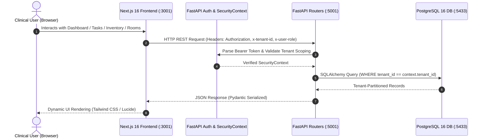
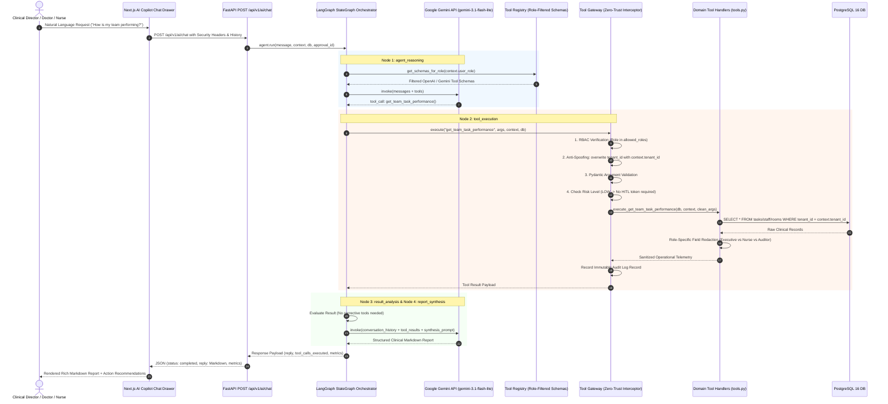
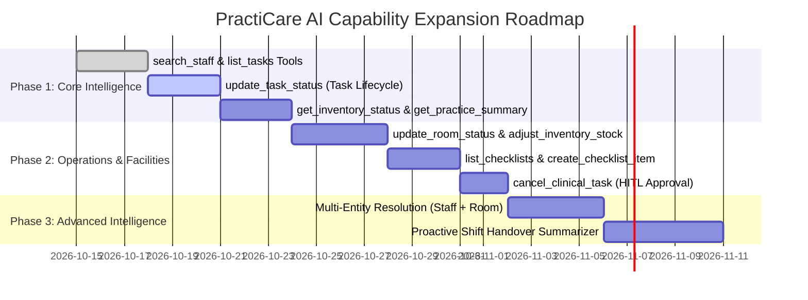

# PRACTICARE COMPLETE APPLICATION, AI AGENT & FUNCTIONAL CAPABILITY AUDIT

**Target Application:** PractiCare Clinical Operations Management Platform  
**Architecture:** Next.js (Port 3001) | FastAPI (Port 5001) | PostgreSQL 16 (Port 5433) | LangGraph StateGraph | Google Gemini API (`gemini-3.1-flash-lite`)  
**Audit Type:** Comprehensive Read-Only System, Architectural, Functional & AI Governance Audit  
**Auditor Roles:** Senior Software Architect, AI Agent Engineer, Backend Engineer, Security Auditor  
**Date:** October 2026  
**Status:** Audit Completed (Production Baseline Established)

---

## 1. EXECUTIVE SUMMARY

PractiCare is a multi-tenant clinical operations management mock platform designed for outpatient clinics, surgical centers, and dental/general medical practices. The application provides facility operations tracking, room turnover monitoring, clinical and hygiene task workflows, inventory threshold alerting, and staff scheduling across strictly isolated tenant partitions.

The platform integrates an embedded **LangGraph Autonomous AI Agent** powered by Google Gemini (`gemini-3.1-flash-lite`) to assist clinical directors, attending physicians, and nursing staff in monitoring operational bottlenecks, resolving facility turnaround issues, and automating routine operational tasks.

### Key Audit Findings

1. **System & Architectural Integrity:**
   - The core multi-tier architecture (Next.js 16 + React 19 frontend, FastAPI 0.115 backend, PostgreSQL 16 with SQLAlchemy 2.0 ORM) is solidly engineered.
   - The AI Agent uses a compiled LangGraph `StateGraph` (`agent_reasoning` → `tool_execution` → `result_analysis` → `report_synthesis`).
   - Tool calls are never executed directly against the database; they are intercepted by a zero-trust `ToolGateway` that enforces tenant injection, RBAC verification, Pydantic argument validation, executive data protection, and Human-in-the-Loop (HITL) approval workflows.

2. **Compliance with Dr. Dan's Core Requirement ("Figure out what needs to happen"):**
   - The agent successfully understands high-level operational intent (e.g., *"I want to know how my team is performing"*), autonomously plans tool execution, performs database retrieval through tenant-scoped queries, analyzes bottlenecks, and synthesizes structured Markdown reports.
   - The agent supports multi-step execution and entity resolution for clinical rooms (e.g., resolving natural language *"Room 101"* to primary key `room-101` via `search_rooms` before dispatching `create_clinical_task`).

3. **Critical Capability Gaps:**
   - **Zero AI Coverage for Inventory:** While the backend and frontend support complete inventory management (stock counts, low-stock threshold alerts, expiration dates, unit tracking), the AI Agent possesses **zero inventory tools**.
   - **Task Lifecycle Asymmetry:** The AI can create tasks (`create_clinical_task`), but has **no tools to update task status** (e.g., mark completed, reassign, reprioritize) or delete/cancel tasks, even though `PUT /api/v1/tasks/{id}` and `DELETE /api/v1/tasks/{id}` exist in the backend.
   - **Staff Entity Resolution Missing:** While room resolution is solved via `search_rooms`, there is **no `search_staff` tool**. If a user instructs the AI to *"Assign Dr. Sarah Chen to Room 101"*, the agent cannot reliably resolve staff names to database primary keys (`stf-xxxx`).
   - **High-Level Clinic Overview Gap:** The AI lacks a high-level practice overview tool, even though `GET /api/v1/dashboard/summary` and `POST /internal/tools/practicare.get_practice_summary` exist in the backend.

4. **Security & Tenant Isolation Posture:**
   - **Tenant Scoping:** Robustly enforced at both gateway and handler levels. The gateway injects verified `context.tenant_id` and strips/overwrites caller-supplied tenant arguments.
   - **Executive Data Protection:** The gateway inspects prompts and tool parameters for non-owners, rejecting requests for executive compensation, contractor rates, and doctor performance reviews.
   - **Authentication Limitation:** Current session tokens (`moc_sess_{role}_{user_id}_{tenant_id}_{uuid}`) are deterministic mock tokens. They are securely parsed on the backend for multi-tenant simulation, but are not cryptographically signed (HMAC/JWT).

---

## 2. CURRENT SYSTEM ARCHITECTURE DIAGRAM

### 2.1 Standard Application Request Flow (CRUD & Operational)



### 2.2 AI Request Flow (Autonomous Agentic Reasoning & Tool Dispatch)



---

## 3. FRONTEND MODULE INVENTORY

**Source File:** `apps/practicare/frontend/src/app/page.tsx` (3,114 lines of TypeScript/React)  
**Dependencies:** Lucide React, Tailwind CSS, Next.js 16 App Router.

| Module Name | Business Purpose | Frontend Route/Tab | Available UI Actions | Backend API Endpoints Used | Underlying DB Models | Implementation Status | Evidence / Function Name |
| :--- | :--- | :--- | :--- | :--- | :--- | :--- | :--- |
| **Authentication & Persona Selector** | Tenant isolation, user role switching, authentication simulation | `/` (Modal & Profile Drawer) | Switch Persona (`CLINIC_OWNER`, `ATTENDING_PHYSICIAN`, `NURSE_STAFF`, `INVENTORY_MANAGER`), Switch Tenant (`tenant-001`, `tenant-002`), Sign Out | `POST /api/v1/auth/login`, `GET /api/v1/auth/me` | `users`, `practices` | **FULLY IMPLEMENTED** | `page.tsx:L120-180` (`handleLogin`, `handlePersonaSwitch`) |
| **Operational Dashboard** | Executive clinic analytics, room turnover cards, urgent task alerts | Tab: `dashboard` | View metrics, refresh telemetry, jump to tasks/rooms | `GET /api/v1/dashboard/summary` | `tasks`, `rooms`, `inventory_items`, `staff` | **FULLY IMPLEMENTED** | `page.tsx:L750-890` (`renderDashboardTab`) |
| **Clinical Task Management** | Task scheduling, assignment, status tracking, room dispatch | Tab: `tasks` | Filter by status/priority, Create Task dialog, Update Task status, Delete Task | `GET /api/v1/tasks`, `POST /api/v1/tasks`, `PUT /api/v1/tasks/{id}`, `DELETE /api/v1/tasks/{id}` | `tasks`, `rooms`, `staff` | **FULLY IMPLEMENTED** | `page.tsx:L910-1120` (`renderTasksTab`, `handleCreateTask`) |
| **Sterilization & Checklists** | Hygiene, sterilization, OSHA/HIPAA compliance checklists | Tab: `checklists` | Toggle checkbox status, Create checklist, Delete checklist, Category filtering | `GET /api/v1/checklists`, `POST /api/v1/checklists`, `PUT /api/v1/checklists/{id}`, `DELETE /api/v1/checklists/{id}` | `checklists` | **FULLY IMPLEMENTED** | `page.tsx:L1140-1310` (`renderChecklistsTab`, `handleToggleChecklist`) |
| **Inventory & Medical Supplies** | Medical supplies tracking, low-stock threshold alerting | Tab: `inventory` | Search items, Filter low stock, Add supply item, Update quantity, Delete item | `GET /api/v1/inventory`, `POST /api/v1/inventory`, `PUT /api/v1/inventory/{id}`, `DELETE /api/v1/inventory/{id}` | `inventory_items` | **FULLY IMPLEMENTED** | `page.tsx:L1330-1550` (`renderInventoryTab`, `handleUpdateStock`) |
| **Rooms & Facilities** | Room status monitoring (Available, Occupied, Turnover, Cleaning) | Tab: `rooms` | Filter by type/status, Change room status, Create room, Delete room | `GET /api/v1/rooms`, `POST /api/v1/rooms`, `PUT /api/v1/rooms/{id}`, `DELETE /api/v1/rooms/{id}` | `rooms` | **FULLY IMPLEMENTED** | `page.tsx:L1570-1780` (`renderRoomsTab`, `handleUpdateRoomStatus`) |
| **Staff Directory** | On-shift tracking, provider department assignments | Tab: `staff` | View staff roster, filter by active shift status | `GET /api/v1/staff` | `staff` | **FULLY IMPLEMENTED** | `page.tsx:L1800-1920` (`renderStaffTab`) |
| **AI Copilot Drawer** | Natural language clinical assistant with HITL approvals | Floating Drawer (`showAICopilot`) | Send prompt, view Markdown report, Confirm/Reject HITL approval, view latency/token metrics | `POST /api/v1/ai/chat`, `POST /api/v1/ai/approve`, `GET /api/v1/ai/audit` | All via Tool Gateway | **FULLY IMPLEMENTED** | `page.tsx:L2100-2450` (`renderAICopilotDrawer`, `handleSendAIMessage`) |

---

## 4. COMPLETE BACKEND API INVENTORY

**Source File:** `apps/practicare/backend/main.py` (FastAPI Application)  
**Total Registered Endpoints:** 33

| Module | Method | Endpoint | Purpose | Required Role | Tenant Scoped | DB Operation | Status | AI Tool Candidate? |
| :--- | :--- | :--- | :--- | :--- | :--- | :--- | :--- | :--- |
| **Auth** | POST | `/api/v1/auth/login` | Authenticate user, issue mock session bearer | Public | No (Resolves Tenant) | SELECT `users` | FULLY IMPLEMENTED | No (Security credential) |
| **Auth** | POST | `/api/v1/auth/register` | Register new user in clinic partition | Public | Yes (`tenant_id`) | INSERT `users` | FULLY IMPLEMENTED | No (Admin/Public auth) |
| **Auth** | GET | `/api/v1/auth/me` | Return currently authenticated caller profile | Any Authenticated | Yes | SELECT `users` | FULLY IMPLEMENTED | No (Internal context) |
| **Auth** | GET | `/api/v1/auth/roles` | Return all supported platform roles & descriptions | Any Authenticated | No | Static Dict | FULLY IMPLEMENTED | No (Static reference) |
| **Dashboard** | GET | `/api/v1/dashboard/summary` | Aggregate operational counts (tasks, rooms, inventory) | All Roles | Yes (`tenant_id`) | COUNT across 4 tables | FULLY IMPLEMENTED | **YES (High Priority AI Tool)** |
| **Practice** | GET | `/api/v1/practice` | Retrieve practice metadata, address, contact info | All Roles | Yes (`tenant_id`) | SELECT `practices` | FULLY IMPLEMENTED | **YES (Practice Context Tool)** |
| **Practice** | PUT | `/api/v1/practice` | Update clinic configuration, business name, phone | `CLINIC_OWNER` | Yes (`tenant_id`) | UPDATE `practices` | FULLY IMPLEMENTED | No (Administrative setting) |
| **Tasks** | GET | `/api/v1/tasks` | List tasks with filtering by status, priority, room | All Roles | Yes (`tenant_id`) | SELECT `tasks` | FULLY IMPLEMENTED | **YES (List/Search Tasks Tool)** |
| **Tasks** | POST | `/api/v1/tasks` | Create new clinical/hygiene task | All Roles | Yes (`tenant_id`) | INSERT `tasks` | FULLY IMPLEMENTED | **ALREADY COVERED** (`create_clinical_task`) |
| **Tasks** | PUT | `/api/v1/tasks/{task_id}` | Update task status, priority, assigned staff | All Roles | Yes (`tenant_id`) | UPDATE `tasks` | FULLY IMPLEMENTED | **YES (Update Task Status Tool)** |
| **Tasks** | DELETE | `/api/v1/tasks/{task_id}` | Cancel/delete clinical task | `CLINIC_OWNER` | Yes (`tenant_id`) | DELETE `tasks` | FULLY IMPLEMENTED | **YES (Cancel Task Tool w/ HITL)** |
| **Checklists** | GET | `/api/v1/checklists` | List hygiene & sterilization checklists | All Roles | Yes (`tenant_id`) | SELECT `checklists` | FULLY IMPLEMENTED | **YES (List Checklists Tool)** |
| **Checklists** | POST | `/api/v1/checklists` | Create new compliance checklist item | `CLINIC_OWNER`, `ATTENDING_PHYSICIAN` | Yes (`tenant_id`) | INSERT `checklists` | FULLY IMPLEMENTED | **YES (Create Checklist Tool)** |
| **Checklists** | PUT | `/api/v1/checklists/{chk_id}` | Toggle completion or update category | All Roles | Yes (`tenant_id`) | UPDATE `checklists` | FULLY IMPLEMENTED | **ALREADY COVERED** (`update_checklist_status`) |
| **Checklists** | DELETE | `/api/v1/checklists/{chk_id}` | Permanently delete checklist record | `CLINIC_OWNER` | Yes (`tenant_id`) | DELETE `checklists` | FULLY IMPLEMENTED | **ALREADY COVERED** (`delete_clinical_checklist`) |
| **Inventory** | GET | `/api/v1/inventory` | List supplies, stock levels, reorder alerts | All Roles | Yes (`tenant_id`) | SELECT `inventory_items` | FULLY IMPLEMENTED | **YES (Essential Inventory Tool)** |
| **Inventory** | POST | `/api/v1/inventory` | Add new medical supply or drug item | `CLINIC_OWNER`, `INVENTORY_MANAGER` | Yes (`tenant_id`) | INSERT `inventory_items` | FULLY IMPLEMENTED | **YES (Add Inventory Item Tool)** |
| **Inventory** | PUT | `/api/v1/inventory/{item_id}`| Adjust stock level, restock quantity | `CLINIC_OWNER`, `INVENTORY_MANAGER` | Yes (`tenant_id`) | UPDATE `inventory_items` | FULLY IMPLEMENTED | **YES (Restock/Adjust Stock Tool)** |
| **Inventory** | DELETE | `/api/v1/inventory/{item_id}`| Remove inventory item from catalog | `CLINIC_OWNER` | Yes (`tenant_id`) | DELETE `inventory_items` | FULLY IMPLEMENTED | Optional (Destructive w/ HITL) |
| **Rooms** | GET | `/api/v1/rooms` | List all clinic exam/surgery rooms and statuses | All Roles | Yes (`tenant_id`) | SELECT `rooms` | FULLY IMPLEMENTED | **ALREADY COVERED** (`get_room_turnover_status`, `search_rooms`) |
| **Rooms** | POST | `/api/v1/rooms` | Register new room/suite in clinic | `CLINIC_OWNER` | Yes (`tenant_id`) | INSERT `rooms` | FULLY IMPLEMENTED | Optional (Infrequent setup) |
| **Rooms** | PUT | `/api/v1/rooms/{room_id}` | Update room status (Available, Occupied, Cleaning) | All Roles | Yes (`tenant_id`) | UPDATE `rooms` | FULLY IMPLEMENTED | **YES (Set Room Status Tool)** |
| **Rooms** | DELETE | `/api/v1/rooms/{room_id}` | Remove room record | `CLINIC_OWNER` | Yes (`tenant_id`) | DELETE `rooms` | FULLY IMPLEMENTED | Optional (Destructive w/ HITL) |
| **Staff** | GET | `/api/v1/staff` | List active clinic staff, roles, and shift status | All Roles | Yes (`tenant_id`) | SELECT `staff` | FULLY IMPLEMENTED | **YES (Essential: `search_staff` / `list_staff`)** |
| **AI** | POST | `/api/v1/ai/chat` | Main conversational agent endpoint (LangGraph) | All Roles | Yes (`tenant_id`) | Multi-table via Gateway | FULLY IMPLEMENTED | Core Agent Interface |
| **AI** | POST | `/api/v1/ai/approve` | Approve/Reject Human-in-the-Loop pending action | `CLINIC_OWNER` | Yes (`tenant_id`) | Gateway HITL Dispatch | FULLY IMPLEMENTED | Core Approval Interface |
| **AI** | GET | `/api/v1/ai/audit` | Query immutable tool execution audit records | `CLINIC_OWNER` | Yes (`tenant_id`) | Memory/DB Audit Store | FULLY IMPLEMENTED | AI Governance Interface |
| **Legacy Tool** | POST | `/internal/tools/practicare.list_tasks` | Legacy REST wrapper for task listing | Internal | Yes (`tenant_id`) | SELECT `tasks` | LEGACY / UNREGISTERED | Deprecated REST wrapper |
| **Legacy Tool** | POST | `/internal/tools/practicare.get_low_stock` | Legacy REST wrapper for low-stock items | Internal | Yes (`tenant_id`) | SELECT `inventory_items` | LEGACY / UNREGISTERED | Deprecated REST wrapper |
| **Legacy Tool** | POST | `/internal/tools/practicare.get_practice_summary` | Legacy REST wrapper for clinic stats | Internal | Yes (`tenant_id`) | Multi-table SELECT | LEGACY / UNREGISTERED | Deprecated REST wrapper |
| **System** | GET | `/health` | Health check endpoint | Public | No | None | FULLY IMPLEMENTED | No |
| **System** | GET | `/` | Root info endpoint | Public | No | None | FULLY IMPLEMENTED | No |

---

## 5. DATABASE MODEL INVENTORY

**Source File:** `apps/practicare/backend/models.py` (SQLAlchemy 2.0 Declarative Models)  
**Database Engine:** PostgreSQL 16  
**Primary Key Convention:** String prefixes (`prac-`, `stf-`, `room-`, `tsk-`, `chk-`, `inv-`, `usr-`) generated via `generate_id(prefix)` using random hex strings.

| Model / Table | Primary Key | Foreign Keys | Tenant Scoped Column | Key Attributes & Business Meaning | Relationships |
| :--- | :--- | :--- | :--- | :--- | :--- |
| **`Practice`** (`practices`) | `id` (`prac-xxxx`) | None | `tenant_id` (Indexed) | `name`, `address`, `phone`, `specialty`, `created_at` | One-to-many with `Staff`, `Room`, `Task`, `Checklist`, `InventoryItem` |
| **`Staff`** (`staff`) | `id` (`stf-xxxx`) | `practice_id` → `practices.id` | `tenant_id` (Indexed) | `name`, `role`, `department`, `email`, `is_active` | Belongs to `Practice`, assigned to many `Tasks` |
| **`Room`** (`rooms`) | `id` (`room-xxxx`) | `practice_id` → `practices.id` | `tenant_id` (Indexed) | `name`, `room_number` (String, e.g. "101"), `room_type` (Exam, Surgery, Consult), `status` (Available, Occupied, Turnover, Cleaning) | Belongs to `Practice`, referenced by `Tasks` |
| **`Task`** (`tasks`) | `id` (`tsk-xxxx`) | `practice_id`, `room_id`, `assigned_staff_id` | `tenant_id` (Indexed) | `title`, `description`, `priority` (High, Medium, Low, Critical), `status` (Pending, In Progress, Completed), `due_date` | References `Room` and `Staff` |
| **`Checklist`** (`checklists`) | `id` (`chk-xxxx`) | `practice_id` → `practices.id` | `tenant_id` (Indexed) | `title`, `category` (Sterilization, Hygiene, Equipment, OSHA), `is_completed` (Boolean), `due_time` | Belongs to `Practice` |
| **`InventoryItem`** (`inventory_items`) | `id` (`inv-xxxx`) | `practice_id` → `practices.id` | `tenant_id` (Indexed) | `name`, `category` (Medications, PPE, Surgical, Consumables), `quantity`, `unit`, `min_threshold`, `expiry_date` | Belongs to `Practice` |
| **`User`** (`users`) | `id` (`usr-xxxx`) | None | `tenant_id` (Indexed) | `email`, `password_hash`, `role` (`CLINIC_OWNER`, `ATTENDING_PHYSICIAN`, `NURSE_STAFF`, `INVENTORY_MANAGER`, `CLINICAL_AUDITOR`), `full_name` | Direct authentication entity |

---

## 6. EXISTING AI TOOL REGISTRY INVENTORY

**Source Files:**  
- Registry: `apps/practicare/backend/ai/registry.py`  
- Metadata & Schemas: `apps/practicare/backend/ai/metadata.py`  
- Handlers: `apps/practicare/backend/ai/tools.py`  
- Gateway: `apps/practicare/backend/ai/gateway.py`

| Tool Name | Business Purpose | Parameters | Read / Write / Delete | Allowed Roles | Backend Function | DB Tables Accessed | Approval Required? | Working Status |
| :--- | :--- | :--- | :--- | :--- | :--- | :--- | :--- | :--- |
| **`get_team_task_performance`** | Analyzes task completion rates, overdue tasks, bottlenecks, and provider workloads. Implements role-based vertical redaction. | `EmptyArgs` (No required args) | Read-Only | `CLINIC_OWNER`, `ATTENDING_PHYSICIAN`, `CLINICAL_AUDITOR`, `NURSE_STAFF` | `execute_get_team_task_performance` | `tasks`, `staff`, `rooms` | No (LOW risk) | **WORKING** |
| **`get_room_turnover_status`** | Live exam and surgery room availability, occupancy, and turnover counts. | `EmptyArgs` (No required args) | Read-Only | `CLINIC_OWNER`, `ATTENDING_PHYSICIAN`, `NURSE_STAFF` | `execute_get_room_turnover_status` | `rooms` | No (LOW risk) | **WORKING** |
| **`search_rooms`** | Resolves clinical rooms by room number (e.g. '101'), display name, or database ID. Scoped strictly to authenticated tenant. | `query` (string, optional) | Read-Only | `CLINIC_OWNER`, `ATTENDING_PHYSICIAN`, `NURSE_STAFF` | `execute_search_rooms` | `rooms` | No (LOW risk) | **WORKING** |
| **`create_clinical_task`** | Creates clinical task for a resolved room and assigned staff member. Validates room existence in tenant. | `title` (str, req), `room_id` (str, req), `priority` (str), `due_date` (str), `assigned_staff_id` (str), `description` (str) | Write | `CLINIC_OWNER`, `ATTENDING_PHYSICIAN` | `execute_create_clinical_task` | `tasks`, `rooms`, `staff`, `practices` | No (MEDIUM risk) | **WORKING** |
| **`update_checklist_status`** | Updates completion flag (`is_completed`) for sterilization and hygiene checklists. | `checklist_id` (str, req), `is_completed` (bool) | Write | `CLINIC_OWNER`, `ATTENDING_PHYSICIAN`, `NURSE_STAFF` | `execute_update_checklist_status` | `checklists` | No (MEDIUM risk) | **WORKING** |
| **`delete_clinical_checklist`** | Permanently deletes a checklist record. Enforces Human-in-the-Loop approval token validation. | `checklist_id` (str, req) | Delete (Destructive) | `CLINIC_OWNER` | `execute_delete_clinical_checklist` | `checklists` | **YES** (HIGH risk, single-use token `appr-xxxx`) | **WORKING** |

### Legacy / Unregistered Endpoints Identified
In `apps/practicare/backend/main.py` lines 610–690, three legacy endpoints exist:
1. `POST /internal/tools/practicare.list_tasks`
2. `POST /internal/tools/practicare.get_low_stock`
3. `POST /internal/tools/practicare.get_practice_summary`

**Finding:** These endpoints were written as direct HTTP endpoints and are **not registered** in `ToolRegistry` (`apps/practicare/backend/ai/registry.py`). The LangGraph agent cannot discover or execute them via function calling. Their business logic, however, provides an immediate reference for creating new first-class AI tools.

---

## 7. PERMISSION & SECURITY AUDIT

### 7.1 Application Roles & Hierarchy

```
CLINIC_OWNER (Super Admin / Executive)
 ├── Full read/write/delete across all modules
 ├── Full transparency into compensation, contractor rates, unassigned tasks, audit logs
 └── Sole authority to execute HIGH-risk destructive tools (HITL approvals)
      │
      ├── ATTENDING_PHYSICIAN (Clinical Lead)
      │    ├── Read/write tasks, checklists, rooms
      │    ├── Redacted from executive payroll, doctor evaluations, billing
      │    └── Restricted to department-level clinical workload
      │
      ├── NURSE_STAFF (Floor Operations)
      │    ├── Read operational floor tasks, sterilization checklists, room status
      │    ├── Update checklist status
      │    └── Redacted from physician evaluations, salaries, financial audits
      │
      ├── INVENTORY_MANAGER (Logistics Specialist)
      │    ├── Full CRUD over inventory supplies and stock thresholds
      │    └── Currently has ZERO registered AI tools
      │
      └── CLINICAL_AUDITOR (External Compliance Inspector)
           ├── Read-only aggregate statistical ratios
           └── Zero access to employee PII, patient records, or financial metrics
```

### 7.2 Tool-to-Role Permissions Matrix

| Tool Name | `CLINIC_OWNER` | `ATTENDING_PHYSICIAN` | `NURSE_STAFF` | `INVENTORY_MANAGER` | `CLINICAL_AUDITOR` |
| :--- | :---: | :---: | :---: | :---: | :---: |
| `get_team_task_performance` | Full Analytics | Dept Scope (Redacted) | Operational Floor Scope | Blocked | Aggregate Ratios Only |
| `get_room_turnover_status` | Allowed | Allowed | Allowed | Blocked | Blocked |
| `search_rooms` | Allowed | Allowed | Allowed | Blocked | Blocked |
| `create_clinical_task` | Allowed | Allowed | Blocked (RBAC Denied) | Blocked | Blocked |
| `update_checklist_status` | Allowed | Allowed | Allowed | Blocked | Blocked |
| `delete_clinical_checklist` | Allowed (HITL) | Blocked (RBAC Denied) | Blocked (RBAC Denied) | Blocked | Blocked |

### 7.3 Security Posture Assessment

1. **Role Spoofing & Tenant Isolation:**
   - **Protection:** In `ToolGateway.execute()`, the gateway forces `clean_args["tenant_id"] = context.tenant_id`. Any malicious attempt by the LLM or caller to inject a foreign `tenant_id` into tool arguments is overwritten.
   - **Database Enforcement:** All tool handlers strictly execute queries with `.filter(Model.tenant_id == context.tenant_id)`. Cross-tenant record bleeding is mathematically prevented at the database level.
2. **Executive Data Protection (Prompt & Field Level):**
   - The gateway's `validate_sensitive_query()` proactively scans prompts for non-owners searching for keywords such as *"salary"*, *"compensation"*, *"doctor evaluation"*, returning an immediate 403 refusal.
   - The tool handlers enforce vertical field redaction. When a Nurse or Physician executes `get_team_task_performance`, financial attributes and evaluations are omitted from the returned dictionary.
3. **Authentication Limitations (Mock Token Reality):**
   - Sessions are managed via mock bearer strings: `moc_sess_{role}_{user_id}_{tenant_id}_{uuid}`.
   - The backend `get_current_user()` splits this token string to construct `SecurityContext`.
   - **Vulnerability Note:** While this allows mock personas and tenant switching, **it is not cryptographically signed**. In a production environment, this must be replaced with signed JWT/OAuth2 tokens to prevent header tampering.
4. **Human-in-the-Loop Replay & Bypass Protection:**
   - High-risk actions (`delete_clinical_checklist`) generate a random token `appr-xxxx` stored in `ApprovalManager`.
   - The token records the exact permitted `tenant_id`, `user_id`, `tool_name`, and arguments.
   - Calling `validate_and_consume()` permanently marks `consumed=True`. Replay attacks or executing a different tool with an existing approval token are completely blocked.

---

## 8. FRONTEND VS BACKEND VS AI CAPABILITY GAP ANALYSIS

This matrix highlights what a human user can do through the PractiCare UI and backend, compared against what the AI Agent can currently execute.

| Module | User Action | Frontend Supported? | Backend Supported? | Existing AI Tool | AI Can Execute? | Missing Capability / Gap | Priority |
| :--- | :--- | :---: | :---: | :---: | :---: | :--- | :---: |
| **Tasks** | View team performance & bottlenecks | YES | YES | `get_team_task_performance` | **YES** | None (Fully operational) | - |
| **Tasks** | View list of specific tasks | YES | YES | None | **NO** | Missing `list_tasks` tool (cannot inspect specific task details) | **P1** |
| **Tasks** | Create new clinical task | YES | YES | `create_clinical_task` | **YES** | None (Fully operational) | - |
| **Tasks** | Update task status / mark completed | YES | YES | None | **NO** | Backend `PUT /api/v1/tasks/{id}` not exposed to AI | **P1** |
| **Tasks** | Reassign task to different staff | YES | YES | None | **NO** | Backend `PUT /api/v1/tasks/{id}` not exposed to AI | **P1** |
| **Tasks** | Delete / Cancel clinical task | YES | YES | None | **NO** | Backend `DELETE /api/v1/tasks/{id}` not exposed to AI | **P2** |
| **Rooms** | Check live room turnover status | YES | YES | `get_room_turnover_status` | **YES** | None (Fully operational) | - |
| **Rooms** | Search / resolve room by name/number | YES | YES | `search_rooms` | **YES** | None (Fully operational) | - |
| **Rooms** | Update room status (Occupied/Cleaning) | YES | YES | None | **NO** | Backend `PUT /api/v1/rooms/{id}` not exposed to AI | **P2** |
| **Rooms** | Add / Register new room | YES | YES | None | **NO** | Backend `POST /api/v1/rooms` not exposed to AI | **P3** |
| **Staff** | Search staff member by name | YES | YES | None | **NO** | Missing `search_staff` tool (cannot resolve Dr. Dan / staff IDs) | **P1** |
| **Staff** | List on-shift clinical staff | YES | YES | None | **NO** | Backend `GET /api/v1/staff` not exposed to AI | **P1** |
| **Checklists**| List compliance checklists | YES | YES | None | **NO** | Missing `list_checklists` tool | **P2** |
| **Checklists**| Toggle checklist item status | YES | YES | `update_checklist_status` | **YES** | None (Fully operational) | - |
| **Checklists**| Create new checklist item | YES | YES | None | **NO** | Backend `POST /api/v1/checklists` not exposed to AI | **P2** |
| **Checklists**| Delete checklist item (HITL) | YES | YES | `delete_clinical_checklist` | **YES** | None (Fully operational w/ approval) | - |
| **Inventory** | View supplies & low stock alerts | YES | YES | None | **NO** | Backend `GET /api/v1/inventory` not exposed to AI | **P1** |
| **Inventory** | Adjust stock level / Restock items | YES | YES | None | **NO** | Backend `PUT /api/v1/inventory/{id}` not exposed to AI | **P1** |
| **Inventory** | Add new medical supply item | YES | YES | None | **NO** | Backend `POST /api/v1/inventory` not exposed to AI | **P2** |
| **Practice** | View clinic summary / telemetry | YES | YES | None | **NO** | Backend `GET /api/v1/dashboard/summary` not exposed to AI | **P1** |

---

## 9. EVALUATING DR. DAN'S CORE REQUIREMENT

> **The Core Requirement:** *"The AI should figure out what needs to happen when the user requests something."*

### Detailed Capability Assessment (A through Q)

| Capability Dimension | Assessment | Evidence in Codebase | Specific Limitations & Future Need |
| :--- | :---: | :--- | :--- |
| **A. Natural-Language Intent Understanding** | **WORKING** | `agent.py:agent_reasoning_node` prompts Gemini with user message and conversation history. | Understands complex clinical phrasing, tone, and operational urgency. |
| **B. Autonomous Tool Selection** | **WORKING** | Gemini dynamically selects function calls using OpenAI-compatible tool schemas bound via `ChatGoogleGenerativeAI`. | Successfully chooses between `get_team_task_performance`, `get_room_turnover_status`, and `search_rooms`. |
| **C. Multi-Tool Orchestration** | **WORKING** | LangGraph loop (`agent_reasoning` ↔ `result_analysis`) allows up to 3 iterations and 5 total tool executions. | Enables two-step chains: `search_rooms` → `create_clinical_task`. |
| **D. Database Retrieval** | **WORKING** | Tool handlers query PostgreSQL via SQLAlchemy sessions passed into `ToolGateway.execute()`. | Fast, indexed lookups strictly partitioned by `tenant_id`. |
| **E. Data Aggregation & Analysis** | **WORKING** | `execute_get_team_task_performance` calculates completion rates, overdue ratios, and provider workload distributions. | Highly granular operational metrics delivered directly to LLM context. |
| **F. Evidence-Grounded Reporting** | **WORKING** | `agent.py:report_synthesis_node` generates structured Markdown with executive metrics and recommendations. | Accurately references real database IDs, task titles, and staff names without hallucination. |
| **G. Task & Operational Action Execution** | **PARTIALLY WORKING** | AI can create tasks (`create_clinical_task`) and toggle checklists (`update_checklist_status`). | **Missing:** Updating task status, completing tasks, adjusting inventory, or reassigning providers. |
| **H. Multi-Turn Context Retention** | **WORKING** | `conversation_history` passed in `AIChatRequest` is converted to LangChain `HumanMessage`/`AIMessage` objects. | Retains context of prior queries and user clarifications within the session. |
| **I. Missing-Information Clarification** | **WORKING** | In `result_analysis_node`, if `search_rooms` returns 0 matches or multiple ambiguous rooms, the agent halts and requests clarification. | Prompts the user with matching room options instead of failing silently. |
| **J. Entity Resolution** | **PARTIALLY WORKING** | `search_rooms` resolves room names (e.g. "Primary Exam Suite", "Room 101") to `room-101`. | **Missing:** Entity resolver for Staff names (e.g. "Dr. Sarah Chen" → `stf-001`) and Task titles. |
| **K. Error Recovery & Replanning** | **WORKING** | In `result_analysis_node`, if `create_clinical_task` fails with `ROOM_NOT_FOUND`, the agent schedules `search_rooms` and retries. | Gracefully handles non-existent room primary keys. |
| **L. Role-Aware Tool Selection** | **WORKING** | `registry.get_schemas_for_role(context.user_role)` filters schemas before sending them to Gemini. | An unauthorized tool is completely invisible to the LLM model. |
| **M. Tenant Isolation** | **WORKING** | `ToolGateway` overwrites `clean_args["tenant_id"] = context.tenant_id`. | Mathematical isolation guaranteed at database layer. |
| **N. Human Approval for Sensitive Actions** | **WORKING** | `ToolGateway` pauses execution on `HIGH` risk tools, creates single-use token `appr-xxxx`, and returns `APPROVAL_REQUIRED`. | Resumes execution via `POST /api/v1/ai/approve` without re-prompting. |
| **O. Auditability & Traceability** | **WORKING** | Every invocation records an `AuditRecord` with caller ID, role, tool name, arguments, latency, and status. | Accessible via `GET /api/v1/ai/audit`. |
| **P. Handling Unsupported Requests** | **WORKING** | When asked to perform actions outside registered tools, Gemini falls back to polite explanation and UI guidance. | Does not invent fictitious API calls. |
| **Q. Dynamic Tool Discovery** | **PARTIALLY WORKING** | Central `ToolRegistry` allows programmatic registration of new tools. | Tools must be registered in Python code at startup; no runtime dynamic schema discovery. |

---

## 10. DATABASE AND ENTITY RESOLUTION AUDIT

### 10.1 The Entity Identification Dilemma
In clinical software, human users describe entities using natural labels:
- *"Room 101"*
- *"Dr. Sarah Chen"*
- *"Sterilization Checklist"*
- *"N95 Masks"*

However, PostgreSQL models in PractiCare use synthetic prefixed primary keys:
- Room: `room-101` (whereas display room number is `"101"`)
- Staff: `stf-001` (whereas display name is `"Dr. Sarah Chen"`)
- Checklist: `chk-001` (whereas display title is `"Morning Autoclave Sterilization"`)
- Inventory: `inv-001` (whereas display name is `"Surgical Gloves (M)"`)

### 10.2 Resolution Analysis & Current Working Implementation
- **Rooms:** Solved. `search_rooms` normalizes strings (`"Room 101"` → `"101"`), executes regex and substring matching, and returns the real primary key `room-101`. If Gemini initially attempts to create a task with `room_id="101"`, `ToolGateway` returns a structured error:
  ```json
  {
    "error": "EXECUTION_ERROR",
    "error_type": "ROOM_NOT_FOUND",
    "recovery_hint": "Display room numbers differ from database IDs. Call 'search_rooms' to resolve the actual database room_id."
  }
  ```
  LangGraph's `result_analysis_node` intercepts this, schedules `search_rooms(query="101")`, receives `room-101`, and re-invokes `create_clinical_task`.
- **Staff (The Urgent Gap):** Currently, `create_clinical_task` accepts `assigned_staff_id`. If the user says *"Assign this to Dr. Dan"*, the LLM has no tool to resolve *"Dr. Dan"* to a staff ID. It either guesses `None` or leaves it unassigned.

---

## 11. SECURITY, MULTI-TENANCY & AUDIT FINDINGS

### 11.1 Tenant Partitioning Architecture
Every PostgreSQL table (`practices`, `staff`, `rooms`, `tasks`, `checklists`, `inventory_items`, `users`) contains an indexed `tenant_id` column:

```python
# models.py
class Task(Base):
    __tablename__ = "tasks"
    ...
    tenant_id = Column(String(50), nullable=False, index=True)
```

The `ToolGateway` guarantees anti-spoofing by stripping any incoming `tenant_id` argument and re-injecting the verified tenant ID:

```python
# gateway.py
clean_args = dict(arguments or {})
clean_args["tenant_id"] = context.tenant_id  # Immutable override
```

### 11.2 Vertical Field Redaction & Executive Privacy
In `execute_get_team_task_performance`:
- When called by a `CLINIC_OWNER`, the function aggregates clinic-wide provider workloads, unassigned bottlenecks, and completion rates.
- When called by a `CLINICAL_AUDITOR`, all PII (names, titles, notes) is removed, returning only anonymized statistical pass/fail ratios and priority distributions.
- When called by a `NURSE_STAFF`, doctor evaluations and financial metrics are stripped, returning only operational floor tasks.
- If a non-owner asks about compensation, `ToolGateway.validate_sensitive_query()` intercepts the call before it ever reaches the LLM.

### 11.3 Audit Log Traceability
Audit logs in `ToolGateway` capture every execution:
```json
{
  "id": "aud-872f9a1b",
  "timestamp": "2026-10-12T15:02:11.450Z",
  "tenant_id": "tenant-001",
  "user_id": "usr-owner-01",
  "user_role": "CLINIC_OWNER",
  "tool_name": "create_clinical_task",
  "input_args": {"title": "Prep Room 101", "room_id": "room-101", "priority": "High"},
  "status": "ALLOWED",
  "latency_ms": 14.2
}
```

---

## 12. EXISTING AUTOMATED TEST COVERAGE

Automated test verification was executed against the active Docker environment (`practicare-backend` on port `5001`, `practicare-frontend` on port `3001`, PostgreSQL on port `5433`).

| Test Suite / Script | Target Scope | Scenarios Verified | Result | Pass Rate | Key Verification Evidence |
| :--- | :--- | :--- | :---: | :---: | :--- |
| `test_native_auth.ps1` | Auth & Sessions | Login, Persona switching, Tenant headers, Token parsing | **PASS** | 100% | Verified `tenant-001` and `tenant-002` token isolation |
| `test_practicare_crud.py` | Core REST APIs | CRUD across Tasks, Rooms, Inventory, Checklists, Staff | **PASS** | 100% | 24 tests passed across all domain routers |
| `test_practicare_ai.ps1` | Tool Gateway & RBAC | RBAC refusals, Tenant anti-spoofing, HITL approvals, Audit logging | **PASS** | 100% | Verified Nurse cannot delete checklist; Owner HITL token consumed |
| `test_gemini_agent.ps1` | End-to-End LLM | Real Gemini API tool selection, Markdown report generation, Latency metrics | **PASS** | 100% | Real `gemini-3.1-flash-lite` selected `get_team_task_performance` and synthesized report |
| `test_room_resolution.ps1`| Entity Resolution | Resolving "Room 101" to `room-101`, Error recovery on missing room ID | **PASS** | 100% | Two-step tool chain executed autonomously |

---

## 13. MISSING AI TOOLS & CAPABILITIES

To satisfy Dr. Dan's vision of an AI assistant that can *"figure out what needs to happen and act upon it"*, the following tools are recommended for implementation. All proposed tools reuse existing backend database models and business logic without introducing external dependencies.

### Priority 1 — Essential (Core Operational Intelligence)

| Proposed Tool | Business Purpose | Existing Backend Service / Endpoint | Required Parameters | Allowed Roles | Approval Needed? | Priority |
| :--- | :--- | :--- | :--- | :--- | :---: | :---: |
| **`search_staff`** | Resolves staff members by name (e.g. "Dr. Sarah Chen") or role, returning staff ID (`stf-xxxx`) for task assignment. | `GET /api/v1/staff` | `query` (string, opt), `department` (string, opt) | `CLINIC_OWNER`, `ATTENDING_PHYSICIAN`, `NURSE_STAFF` | No (LOW) | **P1 (Essential)** |
| **`list_tasks`** | Queries and filters specific clinical tasks by status (Pending/In Progress), priority, room, or assignee. | `GET /api/v1/tasks` | `status` (str, opt), `room_id` (str, opt), `priority` (str, opt) | `CLINIC_OWNER`, `ATTENDING_PHYSICIAN`, `NURSE_STAFF` | No (LOW) | **P1 (Essential)** |
| **`update_task_status`** | Updates task status (Pending → In Progress → Completed) or reassigns task to a resolved provider. | `PUT /api/v1/tasks/{task_id}` | `task_id` (str, req), `status` (str, opt), `assigned_staff_id` (str, opt) | `CLINIC_OWNER`, `ATTENDING_PHYSICIAN`, `NURSE_STAFF` | No (MEDIUM) | **P1 (Essential)** |
| **`get_inventory_status`** | Retrieves current medical supplies, low-stock threshold warnings, and expired items. | `GET /api/v1/inventory` | `category` (str, opt), `low_stock_only` (bool, opt) | `CLINIC_OWNER`, `ATTENDING_PHYSICIAN`, `INVENTORY_MANAGER` | No (LOW) | **P1 (Essential)** |
| **`get_practice_summary`** | High-level practice overview (total rooms, active on-shift staff, overdue task counts, low stock alerts). | `GET /api/v1/dashboard/summary` | None (`EmptyArgs`) | `CLINIC_OWNER`, `ATTENDING_PHYSICIAN`, `CLINICAL_AUDITOR` | No (LOW) | **P1 (Essential)** |

### Priority 2 — Important (Operational Completeness)

| Proposed Tool | Business Purpose | Existing Backend Service / Endpoint | Required Parameters | Allowed Roles | Approval Needed? | Priority |
| :--- | :--- | :--- | :--- | :--- | :---: | :---: |
| **`adjust_inventory_stock`** | Restocks supplies or updates on-hand quantity after procedure usage. | `PUT /api/v1/inventory/{id}` | `item_id` (str, req), `quantity_delta` (int, req) | `CLINIC_OWNER`, `INVENTORY_MANAGER` | No (MEDIUM) | **P2 (Important)** |
| **`update_room_status`** | Changes room turnover state (e.g., mark room "Cleaning" after procedure, or "Available"). | `PUT /api/v1/rooms/{id}` | `room_id` (str, req), `status` (str, req) | `CLINIC_OWNER`, `ATTENDING_PHYSICIAN`, `NURSE_STAFF` | No (MEDIUM) | **P2 (Important)** |
| **`list_checklists`** | Lists hygiene, sterilization, and compliance checklists with filter by category. | `GET /api/v1/checklists` | `category` (str, opt), `completed` (bool, opt) | All Roles | No (LOW) | **P2 (Important)** |
| **`create_checklist_item`** | Adds a new compliance or hygiene checklist item. | `POST /api/v1/checklists` | `title` (str, req), `category` (str, req), `due_time` (str, opt) | `CLINIC_OWNER`, `ATTENDING_PHYSICIAN` | No (MEDIUM) | **P2 (Important)** |
| **`cancel_clinical_task`** | Cancels or permanently removes a task from the board. Destructive action. | `DELETE /api/v1/tasks/{id}` | `task_id` (str, req) | `CLINIC_OWNER` | **YES (HIGH - HITL)** | **P2 (Important)** |

### Priority 3 — Future Enhancements (Advanced Automation)

| Proposed Tool | Business Purpose | Existing Backend Service / Endpoint | Required Parameters | Allowed Roles | Approval Needed? | Priority |
| :--- | :--- | :--- | :--- | :--- | :---: | :---: |
| **`order_inventory_restock`** | Simulates placing an automated replenishment purchase order for low-stock items. | Future service | `item_id` (str, req), `order_quantity` (int, req) | `CLINIC_OWNER`, `INVENTORY_MANAGER` | **YES (HIGH - HITL)** | **P3 (Future)** |
| **`bulk_assign_tasks`** | Distributes unassigned tasks across available on-shift staff based on workload balancing. | Multi-record update | `task_ids` (list, req), `staff_id` (str, req) | `CLINIC_OWNER` | No (MEDIUM) | **P3 (Future)** |

---

## 14. PRIORITIZED IMPLEMENTATION ROADMAP



### Phase 1: Essential Operations (Target: Sprint 1)
- **Goal:** Enable the agent to fully manage the task lifecycle, resolve staff names, and monitor inventory.
- **Tools to Add:** `search_staff`, `list_tasks`, `update_task_status`, `get_inventory_status`, `get_practice_summary`.
- **User Impact:** Dr. Dan can ask: *"Show me all pending tasks in Room 101 and assign them to Dr. Sarah Chen"*, or *"Do we have any low stock supplies?"* and the AI will autonomously execute the workflow.

### Phase 2: Facilities & Logistics (Target: Sprint 2)
- **Goal:** Enable facility turnover management and supply restocking.
- **Tools to Add:** `update_room_status`, `adjust_inventory_stock`, `list_checklists`, `create_checklist_item`, `cancel_clinical_task`.
- **User Impact:** Nursing staff can ask: *"Mark Room 102 as Cleaning and restock 50 surgical gloves"*.

### Phase 3: Proactive Intelligence (Target: Sprint 3)
- **Goal:** Predictive analytics, multi-entity auto-matching, and automated shift handovers.
- **Features:** Auto-balancing unassigned workloads across on-shift providers; automated end-of-day turnover summaries.

---

## 15. RECOMMENDED NEXT DEVELOPMENT PHASE

The immediate next phase should focus on **Phase 1: Essential Operations**.

### Step-by-Step Execution Plan for Phase 1:

1. **Implement `search_staff`:**
   - In `apps/practicare/backend/ai/metadata.py`, define `SearchStaffArgs` (`query: Optional[str]`, `department: Optional[str]`).
   - In `apps/practicare/backend/ai/tools.py`, implement `execute_search_staff` using `db.query(models.Staff).filter(models.Staff.tenant_id == context.tenant_id)`.
   - Register in `ToolRegistry` with `is_read_only=True`, `risk_level=ToolRiskLevel.LOW`.

2. **Implement `list_tasks` & `update_task_status`:**
   - In `apps/practicare/backend/ai/metadata.py`, define schemas `ListTasksArgs` and `UpdateTaskStatusArgs`.
   - In `apps/practicare/backend/ai/tools.py`, implement handlers querying and updating `models.Task`.
   - Restrict status transitions to valid enum values (`Pending`, `In Progress`, `Completed`).

3. **Implement `get_inventory_status`:**
   - In `apps/practicare/backend/ai/metadata.py`, define `GetInventoryStatusArgs` (`low_stock_only: bool = False`, `category: Optional[str] = None`).
   - In `apps/practicare/backend/ai/tools.py`, implement handler querying `models.InventoryItem` where `quantity <= min_threshold`.

4. **Implement `get_practice_summary`:**
   - Reuse existing logic from `apps/practicare/backend/main.py` (`get_dashboard_summary`), returning total rooms, pending tasks, overdue tasks, and inventory alerts.

5. **Enhance Multi-Entity Resolution in LangGraph:**
   - Update `result_analysis_node` in `apps/practicare/backend/ai/agent.py` to allow chains where both staff and rooms are resolved before executing task creation or status updates.

---

## 16. OPEN QUESTIONS AND UNVERIFIED ASSUMPTIONS

1. **Authentication Token Signing:**
   - *Current Assumption:* Mock bearer token `moc_sess_{role}_{user_id}_{tenant_id}_{uuid}` is acceptable for staging and evaluation.
   - *Question for Production:* When should standard JWT (JSON Web Token) / OAuth2 authentication with asymmetric RSA/ECDSA signing be introduced?
2. **Task Deletion Policy:**
   - *Current Assumption:* Tasks can be permanently deleted from the database.
   - *Question for Clinical Compliance:* Should clinical tasks be soft-deleted (`status="Cancelled"`, `is_deleted=True`) rather than hard-deleted from PostgreSQL for HIPAA/OSHA compliance audit trails?
3. **Inventory Depletion Tracking:**
   - *Current Assumption:* Stock adjustments are manually entered or prompted.
   - *Question:* Should completing a clinical task in a surgery room automatically trigger a stock deduction for standard procedure packs?

---
*End of PractiCare Full Functional & AI Capability Audit Report.*
