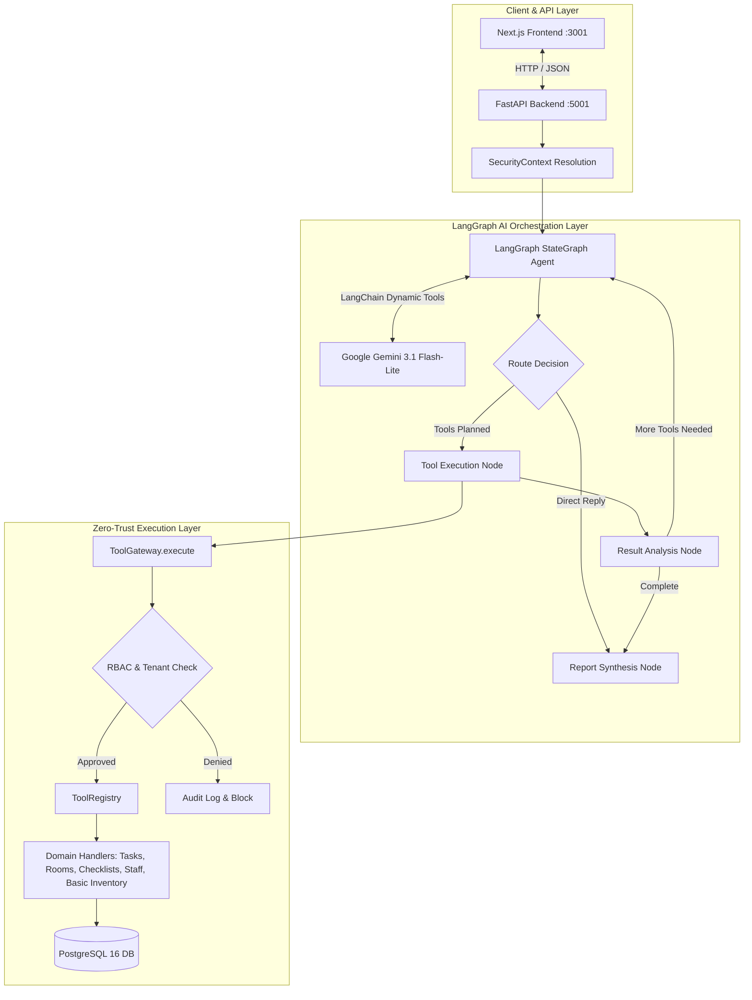
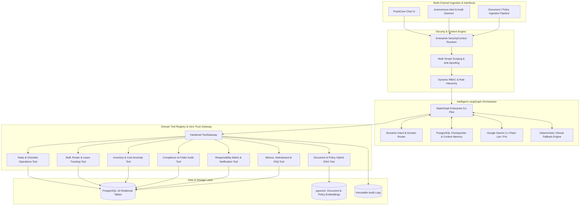
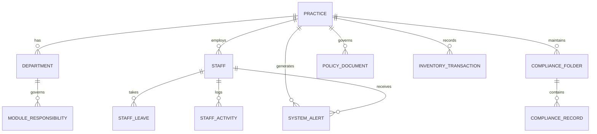
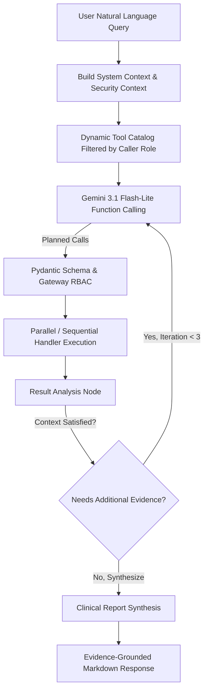
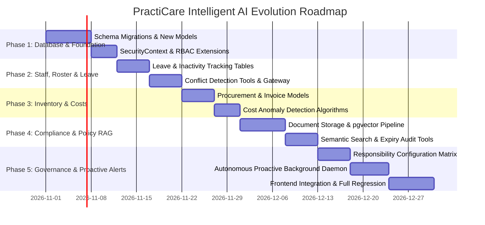

# PractiCare Intelligent AI Assistant: Architecture & Requirement Gap Analysis

**Document Version:** 1.0.0  
**Target System:** PractiCare Clinical Operations Suite (`apps/practicare`)  
**Author:** Senior AI Architect & LangGraph Engineer  
**Date:** October 2026  
**Status:** Architecture Specification & Engineering Gap Analysis  

---

## 1. Executive Summary

PractiCare is an enterprise multi-tenant clinical operations platform built with a FastAPI backend (`port 5001`), Next.js 14 frontend (`port 3001`), PostgreSQL 16 database (`port 5433`), and a LangGraph-orchestrated AI agent powered by Google Gemini (`gemini-3.1-flash-lite`).

The current AI implementation demonstrates solid architectural foundations:
- A formal **LangGraph StateGraph** pipeline (`agent_reasoning` ➔ `tool_execution` ➔ `result_analysis` ➔ `report_synthesis`).
- A **Zero-Trust Security Gateway** (`ToolGateway`) enforcing strict multi-tenant boundaries (`tenant_id`), role-based access control (RBAC), Pydantic argument validation, and audit logging.
- Multi-step reasoning with loop prevention (`MAX_ITERATIONS = 3`), Human-in-the-Loop approvals for destructive actions, and active database persistence.

However, against the comprehensive business requirements defined in **"Pracyicare requirement lists"**, the current system has significant feature and data coverage gaps:
1. **Attendance & Leave Blindness**: The agent cannot correlate task assignments with staff login activity, holiday schedules, sick leave, or Do Not Disturb (DND) status because these tables and attributes do not exist in the database.
2. **Missing Compliance & Policy Management**: There are no database tables, document parsers, or vector retrieval pipelines for compliance folders, policy documents, review cycles (> 6 months), or expiry reminders.
3. **Shallow Inventory & Cost Tracking**: Inventory is limited to unit counts and thresholds; item strengths, purchase orders, invoice numbers, supplier pricing, cost-per-item tracking, and cost anomaly detection are completely missing.
4. **No Responsibility Allocation Matrix**: The platform lacks a module-to-manager routing configuration to determine who receives automated alerts and reminders across departments.
5. **Absent Operational Modules**: Memos, Noticeboards, Internal Messages, Staff Resource Centre, FAQ Manager, and Rostering have no backend data models, APIs, or AI tools.

This document provides a comprehensive gap analysis, establishes code-grounded evidence for every item, and details the target architecture and phased roadmap to evolve PractiCare AI into an enterprise clinical assistant.

---

## 2. Current Architecture vs. Evolved Target Architecture

### 2.1 Current Architecture Overview

#### Strengths of Current Foundation:
- **No Direct DB Access for AI**: Gemini never generates raw SQL; all mutations and queries route strictly through Pydantic-validated `ToolGateway` handlers.
- **Tenant & Role Security**: `tenant_id` is server-injected from verified session tokens, preventing prompt injection cross-tenant leakage.
- **Multi-Step Execution**: The agent automatically plans multi-step operations (e.g., executing `search_staff` to resolve a doctor's UUID before executing `update_checklist`).

#### Architectural Limitations:
- **Model Coverage Limited to 6 Entities**: Only `Practice`, `Staff`, `Room`, `Task`, `Checklist`, and basic `InventoryItem` exist in `models.py`.
- **Static In-Memory Prompting**: The agent has no access to unstructured documents, PDF manuals, or compliance folders.
- **Purely Reactive**: The agent only evaluates state when prompted by a human in chat; there is no background daemon or proactive alert evaluator.

---

### 2.2 Evolved Target Architecture

---

## 3. Comprehensive Requirement Gap Analysis Matrix

The table below cross-references all 42 requirement clauses extracted from the official **"Pracyicare requirement lists"** document against the current codebase:

| Req # | Requirement Clause / Feature | Status | Existing Code / File Reference | Reusable API / Tool | Gap Description & Architectural Remedy | Priority |
| :--- | :--- | :--- | :--- | :--- | :--- | :--- |
| **R01** | Tasks assigned to the staff | **VERIFIED IMPLEMENTED** | `models.py:71-89`, `ai/handlers/tasks.py:15-180` | `list_tasks`, `get_task_details`, `create_clinical_task`, `update_task_status` | Model, schemas, and tools exist and persist in PostgreSQL. | High |
| **R02** | Know when a staff member not logging in who has tasks assigned | **MISSING** | `models.py:37-54`, `models.py:126-140` | `Staff`, `User`, `list_tasks` | `Staff` & `User` models lack `last_login_at` timestamp. No query correlates task assignment with login inactivity. Needs `staff_activity` tracking. | High |
| **R03** | When staff marked as holiday or DND with tasks assigned, alert manager | **MISSING** | `models.py:37-54` (`Staff` only has `on_shift`, `is_active`) | `Staff`, `list_tasks` | No holiday, leave, or Do Not Disturb (DND) attributes or tables exist. Needs `StaffLeave` / `StaffSchedule` model and proactive cross-check tool. | High |
| **R04** | Remind/bring task & leave conflicts to manager's attention | **MISSING** | `ai/handlers/analytics.py` | `get_team_task_performance` | Current analytics only counts generic overdue tasks. Lacks leave-conflict detection and automated manager notification dispatcher. | High |
| **R05** | Checklists: track staff login inactivity and holiday/DND conflicts | **MISSING** | `models.py:90-105`, `ai/handlers/checklists.py` | `list_checklists`, `get_checklist_details` | Checklist model has assignment (`assigned_staff_id`), but no integration with attendance, holiday, or DND states. | High |
| **R06** | AI natural language queries on tasks: who is working on what | **PARTIALLY IMPLEMENTED** | `ai/handlers/tasks.py: execute_list_tasks` | `list_tasks(assigned_staff_id=...)` | Basic filtering works, but multi-criteria NL queries (e.g., "Which nurses have more than 3 high-priority tasks?") require manual multi-step stitching. | Medium |
| **R07** | What will be due when, who is responsible for tasks | **VERIFIED IMPLEMENTED** | `ai/handlers/tasks.py: execute_list_tasks` | `list_tasks(overdue_only=...)` | Returns `due_date`, `assigned_staff_name`, and priority cleanly to Gemini. | Low |
| **R08** | Details of everything related to tasks | **VERIFIED IMPLEMENTED** | `ai/handlers/tasks.py: execute_get_task_details` | `get_task_details(task_id=...)` | Full record retrieval including room details, staff profile, priority, timestamps. | Low |
| **R09** | Compliance: Alert manager if no expiry dates added to compliance records | **MISSING** | `models.py` (No compliance model exists) | None | Complete absence of `ComplianceRecord` or `ComplianceFolder` tables. Needs schema with `expiry_date` and alert trigger. | High |
| **R10** | Compliance: AI knows everything saved in compliance folders | **MISSING** | Backend has no document ingestion or folder models | None | Unstructured compliance files cannot be ingested or read. Requires document ingestion pipeline with text extraction. | High |
| **R11** | Compliance: Answer questions regarding compliance folder contents | **MISSING** | No vector search or RAG pipeline exists | None | Requires semantic search (pgvector) over compliance chunks to provide evidence-grounded answers. | High |
| **R12** | Compliance: Remind manager when folders not updated for > 6 months | **MISSING** | `models.py` | None | Needs `last_reviewed_at` or `updated_at` column and proactive audit query (`updated_at < NOW() - INTERVAL '6 MONTHS'`). | High |
| **R13** | Inventory: Know items, strengths, order dates, invoice numbers | **MISSING** | `models.py:106-122` (`InventoryItem`) | Basic fields in `InventoryItem` | Existing model only has `item_name`, `current_stock`, `min_threshold`, `unit`, `expiry_date`. Missing `strength`, `order_date`, `invoice_number`, `supplier_id`. | High |
| **R14** | Inventory: Stock levels and low stock visibility | **VERIFIED IMPLEMENTED** | `ai/handlers/inventory.py: execute_get_inventory_status` | `get_inventory_status` | Identifies out-of-stock, low-stock, and expiring medical supplies. | Low |
| **R15** | Inventory: Costs tracking for any durations | **MISSING** | `models.py:106-122` | None | No unit purchase cost, purchase date, or invoice transaction history exists in database. | High |
| **R16** | Inventory: Recognize cost anomalies | **MISSING** | None | None | Needs historical unit price analysis to detect spikes (e.g., standard deviation > 20% over 90 days). | Medium |
| **R17** | Inventory: Cost per item and variation across time/suppliers | **MISSING** | None | None | Requires `InventorySupplier`, `PurchaseInvoice`, and item batch tracking models. | Medium |
| **R18** | Documents: Answer any questions regarding documents | **MISSING** | Backend has no Document model | None | No document management system or RAG pipeline exists in PractiCare. | High |
| **R19** | Documents: Identify what is in documents, expiry dates, renewal dates | **MISSING** | None | None | Needs `Document` metadata model (`title`, `doc_type`, `expiry_date`, `renewal_date`, `content_text`). | High |
| **R20** | Policies: Alert manager when policies not reviewed/renewed as planned | **MISSING** | None | None | Needs `PolicyDocument` model with `planned_review_date` and reminder alerts. | High |
| **R21** | Policies: Alert manager when policies not checked for > 6 months | **MISSING** | None | None | Needs `last_checked_at` field and 180-day inactivity evaluation trigger. | High |
| **R22** | Responsibility Allocation: Department-based configuration | **MISSING** | `StaffItem.department` is in frontend UI only | None | No database table defines departments or departmental operational hierarchies. | Medium |
| **R23** | Responsibility Allocation: Reporting entity dropdown per module | **MISSING** | None | None | Needs `ModuleResponsibility` table mapping modules to designated staff user IDs. | High |
| **R24** | Module: Memo | **MISSING** | None | None | No Memo model, API, or AI tool exists. | Medium |
| **R25** | Module: Noticeboard | **MISSING** | None | None | No Noticeboard model, API, or AI tool exists. | Medium |
| **R26** | Module: Messages (Internal Clinic Messaging) | **MISSING** | None | None | No internal messaging model, API, or AI tool exists. | Medium |
| **R27** | Module: Staff Resource Centre | **MISSING** | None | None | No Resource Centre model, API, or AI tool exists. | Medium |
| **R28** | Module: FAQ Manager | **MISSING** | None | None | No FAQ model, API, or AI tool exists. | Low |
| **R29** | Module: Roster | **MISSING** | Only static staff list in `schemas.py:369` | `search_staff` (partial) | No shift roster, shift calendar, or rotation model exists. | High |
| **R30** | Module: Sick Leave | **MISSING** | None | None | No Sick Leave request, approval, or logging system exists. | High |
| **R31** | Module: Holiday Leave | **MISSING** | None | None | No Holiday Leave model, approval, or balance tracking exists. | High |

---

## 4. Source-Code Grounded Analysis of Existing Implementation

### 4.1 Database Models (`models.py`)
Inspecting [`models.py`](file:///d:/Axio360/shared-mcp-moc/apps/practicare/backend/models.py):
- **Implemented**: `Practice` (line 21), `Staff` (line 37), `Room` (line 55), `Task` (line 71), `Checklist` (line 90), `InventoryItem` (line 106), `User` (line 126), `StaffInvitation` (line 143), `AIConversation` (line 168), `AIMessage` (line 182).
- **Evidence of Absence**:
  - `Staff` has only `is_active` (boolean) and `on_shift` (boolean). Lines 37-54 contain no `status` enum, no `leave_start`, `leave_end`, `holiday_status`, `dnd_status`, or `last_login_at`.
  - `InventoryItem` (lines 106-122) contains `current_stock`, `min_threshold`, `unit`, `expiry_date`. It contains no `strength`, `supplier_name`, `order_date`, `invoice_number`, `unit_cost`, or historical price tracking.
  - Zero models exist for `ComplianceFolder`, `Document`, `Policy`, `Memo`, `Noticeboard`, `Message`, `Roster`, `LeaveRequest`, or `ModuleResponsibility`.

### 4.2 Tool Registry (`ai/registry.py`)
Inspecting [`ai/registry.py`](file:///d:/Axio360/shared-mcp-moc/apps/practicare/backend/ai/registry.py):
- Contains **20 registered tools**:
  - Room management: `create_room`, `update_room`, `get_room_details`, `search_rooms`, `get_room_turnover_status`.
  - Task management: `create_clinical_task`, `update_task_status`, `list_tasks`, `get_task_details`.
  - Checklist management: `create_checklist`, `update_checklist`, `update_checklist_status`, `delete_clinical_checklist`, `list_checklists`, `get_checklist_details`.
  - Staff management: `search_staff`, `create_staff_invitation`.
  - Inventory & Analytics: `get_inventory_status`, `get_team_task_performance`, `get_practice_summary`.
- **Evidence of Absence**: No tools exist for document search, policy review, compliance auditing, leave resolution, cost anomaly calculation, or responsibility dispatching.

### 4.3 Tool Gateway & RBAC (`ai/gateway.py` & `ai/context.py`)
Inspecting [`ai/gateway.py`](file:///d:/Axio360/shared-mcp-moc/apps/practicare/backend/ai/gateway.py) and [`ai/context.py`](file:///d:/Axio360/shared-mcp-moc/apps/practicare/backend/ai/context.py):
- Roles configured: `CLINIC_OWNER`, `ATTENDING_PHYSICIAN`, `CLINICAL_AUDITOR`, `NURSE_STAFF`, `INVENTORY_MANAGER`.
- Zero-Trust enforcement: Automatically injects `tenant_id` from `SecurityContext` (lines 130-137), strips caller spoofing parameters, blocks unauthorized role execution (lines 139-160), and logs every attempt to immutable audit storage (lines 25-50).
- This security boundary is robust and will be preserved 100% as new tools are introduced.

### 4.4 LangGraph Agent Pipeline (`ai/agent.py`)
Inspecting [`ai/agent.py`](file:///d:/Axio360/shared-mcp-moc/apps/practicare/backend/ai/agent.py):
- Constructed via `StateGraph(AgentState)` with `MemorySaver` checkpointer (lines 2220-2277).
- Workflow: `START` ➔ `agent_reasoning` ➔ `tool_execution` ➔ `result_analysis` ➔ `report_synthesis` ➔ `END`.
- Dynamic tools: Binds schemas visible to the verified role using `registry.get_schemas_for_role(context.user_role)`.
- Multi-step loops: Loops back from `result_analysis` to `agent_reasoning` when `more_tools_needed` is true and `current_iteration < MAX_ITERATIONS` (lines 2263-2274).
- Regression suite verification (`test_regression.py`): Live tests confirm multi-step tool calls succeed in sequence (e.g., calling `search_staff` to resolve names, then calling `update_checklist` to mutate database state).

---

## 5. Proposed Target Data Models

To satisfy all requirements without breaking existing functionality, the database schema must be extended with the following non-breaking tables and columns:

### 5.1 Staff Attendance, Schedule & Leave
1. **`Staff` modifications (non-breaking column additions)**:
   - `department`: String(100), nullable=True
   - `work_status`: String(30), default='ACTIVE' (values: `ACTIVE`, `ON_LEAVE`, `HOLIDAY`, `DND`, `SICK_LEAVE`)
   - `last_login_at`: DateTime, nullable=True
2. **`staff_leaves` table**:
   - `id`: String(50), PK
   - `tenant_id`: String(50), indexed
   - `staff_id`: FK(`staff.id`)
   - `leave_type`: String(30) (`HOLIDAY`, `SICK`, `UNPAID`, `DND`)
   - `start_date`: DateTime
   - `end_date`: DateTime
   - `approved_by_user_id`: FK(`practicare_users.id`)
   - `status`: String(30) (`PENDING`, `APPROVED`, `REJECTED`)
   - `notes`: Text

### 5.2 Compliance & Documents (RAG Grounding)
1. **`compliance_folders` table**:
   - `id`: String(50), PK
   - `tenant_id`: String(50), indexed
   - `name`: String(150) (e.g., "Infection Control 2026", "OSHA Certifications")
   - `department_id`: String(50), nullable=True
   - `last_reviewed_at`: DateTime
   - `review_cycle_months`: Integer, default=6
   - `responsible_staff_id`: FK(`staff.id`)
2. **`compliance_records` table**:
   - `id`: String(50), PK
   - `tenant_id`: String(50), indexed
   - `folder_id`: FK(`compliance_folders.id`)
   - `title`: String(200)
   - `description`: Text
   - `expiry_date`: String(50), nullable=True  # If missing, triggers R09 alert
   - `document_url`: String(500), nullable=True
   - `content_text`: Text, nullable=True       # Ingested OCR / PDF text
   - `embedding`: Vector(768), nullable=True    # pgvector for semantic Q&A
3. **`policy_documents` table**:
   - `id`: String(50), PK
   - `tenant_id`: String(50), indexed
   - `title`: String(200)
   - `category`: String(100) (e.g., "Clinical Practice", "Fire Safety", "Data Privacy")
   - `version`: String(20), default="1.0"
   - `content_text`: Text
   - `planned_review_date`: DateTime, nullable=True
   - `last_checked_at`: DateTime, default=datetime.utcnow
   - `responsible_staff_id`: FK(`staff.id`)
   - `embedding`: Vector(768), nullable=True

### 5.3 Inventory Procurement & Cost Intelligence
1. **`InventoryItem` modifications (non-breaking column additions)**:
   - `strength`: String(50), nullable=True (e.g., "500mg", "10mg/mL")
   - `batch_number`: String(100), nullable=True
   - `supplier_name`: String(150), nullable=True
   - `latest_unit_cost`: Float, default=0.0
2. **`inventory_transactions` table**:
   - `id`: String(50), PK
   - `tenant_id`: String(50), indexed
   - `item_id`: FK(`inventory_items.id`)
   - `supplier_name`: String(150)
   - `invoice_number`: String(100)
   - `order_date`: DateTime
   - `quantity`: Integer
   - `unit_cost`: Float
   - `total_cost`: Float
   - `created_at`: DateTime

### 5.4 Responsibility Configuration & Alert Matrix
1. **`module_responsibilities` table**:
   - `id`: String(50), PK
   - `tenant_id`: String(50), indexed
   - `module_key`: String(50) (`tasks`, `checklists`, `compliance`, `inventory`, `documents`, `memo`, `noticeboard`, `messages`, `staff_centre`, `faq`, `roster`, `sick_leave`, `holiday_leave`)
   - `department`: String(100), default='ALL'
   - `primary_manager_id`: FK(`staff.id`)
   - `escalation_manager_id`: FK(`staff.id`), nullable=True
   - `alert_channel`: String(30), default='IN_APP' (`IN_APP`, `EMAIL`, `DIGEST`)
2. **`system_alerts` table**:
   - `id`: String(50), PK
   - `tenant_id`: String(50), indexed
   - `alert_type`: String(50) (`TASK_STAFF_OFFLINE`, `STAFF_LEAVE_CONFLICT`, `COMPLIANCE_MISSING_EXPIRY`, `COMPLIANCE_OVERDUE_REVIEW`, `POLICY_OVERDUE_REVIEW`, `INVENTORY_COST_ANOMALY`)
   - `target_staff_id`: FK(`staff.id`) # Manager receiving alert
   - `title`: String(200)
   - `details`: Text
   - `severity`: String(20) (`LOW`, `MEDIUM`, `HIGH`, `CRITICAL`)
   - `is_acknowledged`: Boolean, default=False
   - `created_at`: DateTime

---

## 6. Dynamic Multi-Tool Execution & Prompt Architecture

Rather than hardcoding static regex matches or if-else trees for every potential clinical question, the architecture utilizes **LangGraph Dynamic Tool Routing**:

### 6.1 Tool Categorization for Gemini Dynamic Binding

To prevent context bloat and ensure token efficiency, the tools in `ToolRegistry` are grouped into specialized functional modules:

1. **`ops_tools`**: `list_tasks`, `get_task_details`, `update_task_status`, `create_clinical_task`, `list_checklists`, `update_checklist`, `search_rooms`, `get_room_details`, `update_room`.
2. **`staff_schedule_tools`**: `search_staff`, `get_staff_schedule_and_leave`, `get_unassigned_or_offline_staff_tasks`, `log_staff_leave`.
3. **`compliance_rag_tools`**: `search_compliance_and_policies`, `get_compliance_folder_status`, `get_overdue_document_reviews`, `update_compliance_expiry`.
4. **`inventory_financial_tools`**: `get_inventory_status`, `get_inventory_cost_history`, `detect_inventory_cost_anomalies`.
5. **`responsibility_alert_tools`**: `get_module_responsibility_matrix`, `update_module_reporting_entity`, `list_active_system_alerts`.

### 6.2 Preventing Hallucinations in Document Answers (Evidence Grounding)
When answering queries about compliance or clinical policies:
- The `search_compliance_and_policies` tool queries `pgvector` for top-$k$ relevant chunks using cosine similarity.
- The prompt instructs Gemini:
  > *"You are grounded strictly in the provided document excerpts. Cite document title, section, and last review date. If an excerpt lacks the required answer, state truthfully that the policy repository does not contain this information. Never invent medical policy."*

---

## 7. Phased Implementation Roadmap

### Phase 1: Core Foundation & Database Schema Migrations (Week 1–2)
- Apply non-breaking migrations (`Alembic` or SQLAlchemy `ALTER TABLE ... ADD COLUMN IF NOT EXISTS`).
- Add models for `StaffLeave`, `ComplianceFolder`, `ComplianceRecord`, `PolicyDocument`, `InventoryTransaction`, `ModuleResponsibility`, `SystemAlert`.
- Extend `ROLE_PERMISSIONS` in `ai/context.py` to include granular permissions (`compliance:view`, `compliance:manage`, `policies:view`, `inventory:finance`, `alerts:manage`).

### Phase 2: Staff, Attendance, Roster & Leave Tracking (Week 2–3)
- Implement `staff_schedule_tools`:
  - `get_staff_schedule_and_leave`: Cross-checks on-shift, leave, and DND states.
  - `get_unassigned_or_offline_staff_tasks`: Solves requirements R02, R03, R04, and R05 by detecting tasks/checklists assigned to offline or on-leave staff.
- Ensure manager alerting identifies the designated reporting entity.

### Phase 3: Inventory Cost Intelligence & Anomaly Detection (Week 3–4)
- Populate invoice and pricing transactions (`strength`, `supplier_name`, `invoice_number`, `order_date`, `unit_cost`).
- Implement `detect_inventory_cost_anomalies`: Calculates cost variances across suppliers and historical price spikes (> 20%).
- Satisfies requirements R13, R15, R16, and R17.

### Phase 4: Compliance Folders & Policy Document RAG (Week 4–5)
- Enable `pgvector` extension in PostgreSQL 16.
- Implement text chunking and embedding generation for compliance and policy files.
- Implement `search_compliance_and_policies` and `get_overdue_document_reviews` (> 6 months threshold).
- Satisfies requirements R09, R10, R11, R12, R18, R19, R20, and R21.

### Phase 5: Responsibility Matrix & Proactive Alert Engine (Week 5–6)
- Implement `ModuleResponsibility` configuration endpoint and AI tools.
- Build a lightweight background task (`ProactiveEvaluator`) that runs periodically to:
  1. Detect staff offline/on leave with active tasks ➔ send alert to module manager.
  2. Detect compliance items without expiry dates ➔ send alert to compliance officer.
  3. Detect compliance folders and policies untouched for > 6 months ➔ send reminder.
  4. Flag inventory price spikes upon new invoice ingestion.
- Frontend UI extension: Add dedicated tabs for Compliance, Documents, and Alerts.
- Execute full regression suite ensuring zero regressions across existing apps (`TaxSnap`, `PropSights`, `OnScribe`).

---

## 8. Verification & Safety Guarantees

1. **Preservation of Existing Applications**: All additions are confined to the `practicare` schema or isolated tables. Other workspace applications (`taxsnap`, `propsights`, `onscribe`) remain completely untouched.
2. **Deterministic Fallback Compatibility**: When `AI_AGENT_MODE=deterministic`, rule-based handlers will map directly to the newly registered tools without depending on external API availability.
3. **Rollback & Transaction Isolation**: Every tool execution handler wraps database modifications in atomic transactions (`db.commit()` on success, `db.rollback()` on error).
4. **Audit Immutability**: All queries and mutations—including document searches and automated alerts—log directly to `ToolGateway._audit_logs` for compliance auditing.
