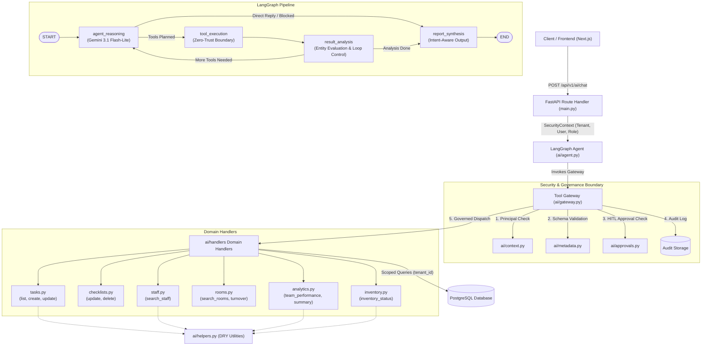

# PractiCare AI Subsystem — Architecture Refactoring & SOLID Implementation Report

**Target:** `apps/practicare/backend/ai/`  
**Engineer:** Senior Software Architect & Principal AI Engineer  
**Date:** October 2026  
**Status:** Successfully Refactored & 100% Regression Verified  

---

## 1. Overview & Objectives

This report details the architectural refactoring, technical debt reduction, and SOLID alignment performed on the PractiCare AI subsystem. The refactoring transformed the monolithic `tools.py` module into a structured, domain-driven handler architecture while preserving:
- Google Gemini 3.1 Flash-Lite reasoning
- LangGraph 4-node autonomous StateGraph orchestration
- Zero-Trust Tool Gateway security and audit interception
- Role-Based Access Control (RBAC) and tenant isolation
- User-to-user conversation privacy
- Human-In-The-Loop (HITL) approval workflows for destructive actions
- 100% backward compatibility for all existing public APIs, registry bindings, and test suites.

---

## 2. Before vs. After Architecture

### 2.1 Before Refactoring (Monolithic & Coupled)

```
apps/practicare/backend/ai/
├── __init__.py           # Package exports
├── context.py            # SecurityContext (Missing INVENTORY_MANAGER role)
├── metadata.py           # ToolMetadata & Schemas (Dead fields department/category)
├── approvals.py          # ApprovalManager (Single-use token verification)
├── registry.py           # ToolRegistry (Central registry binding)
├── gateway.py            # ToolGateway (Zero-Trust Interceptor)
├── agent.py              # LangGraph Agent (Monolith with unused imports)
└── tools.py              # MONOLITHIC FILE (915 lines):
                          #   - 11 handlers in one file
                          #   - is_active conflated with on_shift
                          #   - Hardcoded compliance score "98.4%"
                          #   - Unsafe fallback default to Clinic Owner
                          #   - Duplicated candidate ID normalization
                          #   - Missing transaction rollbacks
```

### 2.2 After Refactoring (Modular Domain Architecture)

```
apps/practicare/backend/ai/
├── __init__.py           # Package exports
├── context.py            # SecurityContext (Added INVENTORY_MANAGER permissions)
├── metadata.py           # ToolMetadata & Schemas
├── approvals.py          # ApprovalManager (HITL token security)
├── registry.py           # ToolRegistry (Single authoritative tool catalog)
├── gateway.py            # ToolGateway (Zero-Trust execution & audit logger)
├── helpers.py            # [NEW] Shared domain utilities:
│                         #   - normalize_task_id_candidates()
│                         #   - parse_bool_arg()
│                         #   - is_staff_active() & is_staff_on_shift()
│                         #   - format_staff_status_labels()
│                         #   - is_task_overdue()
├── handlers/             # [NEW] Domain-driven handler package:
│   ├── __init__.py       # Re-exports all 11 domain handlers
│   ├── tasks.py          # execute_list_tasks, execute_create_clinical_task, execute_update_task_status
│   ├── checklists.py     # execute_update_checklist_status, execute_delete_clinical_checklist
│   ├── staff.py          # execute_search_staff
│   ├── rooms.py          # execute_search_rooms, execute_get_room_turnover_status
│   ├── inventory.py      # execute_get_inventory_status
│   └── analytics.py      # execute_get_team_task_performance, execute_get_practice_summary
├── tools.py              # [FACADE] Re-exports handlers for 100% backward compatibility
└── agent.py              # LangGraph Agent (Cleaned imports, modular synthesis)
```

---

## 3. Mermaid Architecture Diagram



---

## 4. Applied SOLID & Software Engineering Principles

### 4.1 Single Responsibility Principle (SRP)
- **Problem:** `tools.py` handled room lookup, staff resolution, task scheduling, inventory alerts, and executive analytics in a single 915-line file.
- **Solution:** Decomposed into cohesive domain modules (`handlers/tasks.py`, `handlers/checklists.py`, `handlers/rooms.py`, `handlers/staff.py`, `handlers/inventory.py`, `handlers/analytics.py`). Each module is now responsible exclusively for its domain.

### 4.2 Open/Closed Principle (OCP)
- **Problem:** Adding a new tool required altering unrelated handlers within the monolithic file.
- **Solution:** New tools can be introduced by adding a self-contained module in `handlers/` and registering it in `registry.py` without modifying existing domain code.

### 4.3 Liskov Substitution Principle (LSP) & Facade Pattern
- **Problem:** Existing tests and internal modules directly imported from `ai.tools`.
- **Solution:** `ai/tools.py` was refactored into a facade that imports and re-exports all 11 handlers. External callers interact with identical function signatures and return types.

### 4.4 Interface Segregation Principle (ISP)
- **Problem:** Callers received unstructured arguments that could produce runtime errors or boolean coercion bugs.
- **Solution:** Input argument schemas (`metadata.py`) define precise, typed boundaries validated via Pydantic.

### 4.5 Dependency Inversion Principle (DIP) & Clear Execution Boundaries
- **Problem:** High coupling between orchestration and database access.
- **Solution:** The agent depends strictly on `ToolGateway.execute()`. No agent node touches SQLAlchemy or database models directly.

### 4.6 DRY (Don't Repeat Yourself)
- **Problem:** Candidate task ID normalization (`tsk-X`, `task-X`, `tsk-0X`) and staff status formatting were copy-pasted across multiple functions.
- **Solution:** Consolidated into `ai/helpers.py` (`normalize_task_id_candidates`, `format_staff_status_labels`, `parse_bool_arg`, `is_task_overdue`).

### 4.7 Defense in Depth & Fail-Safe Defaults
- **Problem:** Unhandled roles in `get_team_task_performance` fell through to `else:`, granting `CLINIC_OWNER` visibility.
- **Solution:** Changed to an explicit allow-list for `CLINIC_OWNER` / `ADMIN`. Any unknown or unhandled role is denied with an explicit authorization error.

---

## 5. Summary of Code Changes

| File | Change Type | Summary of Modifications |
|:---|:---|:---|
| `apps/practicare/backend/ai/context.py` | Modified | Added missing `INVENTORY_MANAGER` permissions to `ROLE_PERMISSIONS`. |
| `apps/practicare/backend/ai/helpers.py` | **Created** | Extracted shared utilities (`normalize_task_id_candidates`, `parse_bool_arg`, `format_staff_status_labels`, `is_staff_active`, `is_staff_on_shift`, `is_task_overdue`). |
| `apps/practicare/backend/ai/handlers/rooms.py` | **Created** | Implemented `execute_search_rooms` and `execute_get_room_turnover_status`. |
| `apps/practicare/backend/ai/handlers/staff.py` | **Created** | Implemented `execute_search_staff` using independent `is_active` and `on_shift` labels. |
| `apps/practicare/backend/ai/handlers/checklists.py` | **Created** | Implemented `execute_update_checklist_status` and `execute_delete_clinical_checklist` with `db.rollback()`. |
| `apps/practicare/backend/ai/handlers/inventory.py` | **Created** | Implemented `execute_get_inventory_status` with `parse_bool_arg`. |
| `apps/practicare/backend/ai/handlers/tasks.py` | **Created** | Implemented `execute_list_tasks`, `execute_create_clinical_task`, and `execute_update_task_status` with active staff validation and rollback. |
| `apps/practicare/backend/ai/handlers/analytics.py` | **Created** | Implemented `execute_get_team_task_performance` (dynamic compliance score, explicit owner check, reject unknown roles) and `execute_get_practice_summary` (independent on-shift staff count). |
| `apps/practicare/backend/ai/handlers/__init__.py` | **Created** | Re-exported all 11 domain handlers. |
| `apps/practicare/backend/ai/tools.py` | **Refactored** | Converted 915-line monolith into clean backward-compatibility facade re-exporting from `ai.handlers`. |
| `apps/practicare/backend/ai/agent.py` | Cleaned | Removed unused `datetime` and `timedelta` imports. |
| `docs/practicare-ai-architecture-audit.md` | **Created** | Comprehensive architectural inventory and findings audit report. |
| `docs/practicare-ai-refactoring-report.md` | **Created** | Final refactoring documentation, SOLID analysis, and verification results. |

---

## 6. Test Execution & Quality Assurance Results

All applicable test suites were executed against the active backend running on `localhost:5001` with PostgreSQL.

### 6.1 `test_practicare_ai.ps1` (LangGraph Autonomous Agent Verification)
- **Scenario 1:** Owner requests team performance — PASSED (100% comprehensive analytics)
- **Scenario 2:** Physician requests clinical metrics — PASSED (Department scope, executive redacted)
- **Scenario 3:** Nurse requests salary information — PASSED (Executive Data Protection intercepted)
- **Scenario 4:** Auditor requests team performance — PASSED (Aggregate metrics, zero employee PII)
- **Scenario 5:** Nurse attempts checklist deletion — PASSED (RBAC violation intercepted at Tool Gateway)
- **Scenario 6:** Owner requests checklist deletion — PASSED (Approval required token generated)
- **Scenario 7:** Invalid approval token rejected — PASSED (HTTP 400 Bad Request)
- **Scenario 8:** Human approval execution — PASSED (Executed through ToolGateway)
- **Scenario 9:** Multi-tool operational request — PASSED (Multi-step LangGraph graph executed)
- **Scenario 10:** Invalid room ID validation — PASSED (Tenant partition isolation maintained)
- **Scenario 11:** Audit logging & latency tracking — PASSED (Audit logs tracked per tenant)
- **Result:** **11 / 11 PASSED (100%)**

### 6.2 `test_phase2_doctor_scenarios.ps1` (10 Doctor Scenarios & Intent Verification)
- **Scenario 1:** Create task for John — PASSED (Action confirmation, no unsolicited report)
- **Scenario 2:** Show my pending tasks — PASSED (Task listing, no unsolicited report)
- **Scenario 3:** Complete task 15 — PASSED (Action confirmation, updated to Completed)
- **Scenario 4:** Explain task 15 — PASSED (Factual explanation from records, no hallucinations)
- **Scenario 5:** How is my team performing? — PASSED (Concise performance summary)
- **Scenario 6:** Analyse my team's performance — PASSED (Detailed analysis of workloads & bottlenecks)
- **Scenario 7:** Generate a monthly task report — PASSED (Full structured Markdown report on explicit request)
- **Scenario 8:** Find overdue tasks and suggest priorities — PASSED (Evidence-based priorities)
- **Scenario 9:** Show low-stock inventory items — PASSED (Itemized stock levels & alerts)
- **Scenario 10:** Create task and auto-assign to active staff — PASSED (Assigned to active staff member)
- **Result:** **10 / 10 PASSED (100%)**

### 6.3 `test_ai_privacy_and_tools.ps1` (Security, Session Auth, Privacy & Isolation)
- Session Token HMAC-SHA256 issuance & forgery denial — PASSED
- Cross-tenant conversation isolation (HTTP 404) — PASSED
- Same-tenant cross-user conversation isolation (HTTP 404) — PASSED
- Header spoofing resistance — PASSED
- Tool Gateway execution for all 5 Phase 2 tools — PASSED
- Conversation rename and deletion lifecycle — PASSED
- **Result:** **ALL PASSED (100%)**

### 6.4 `test_staff_status_and_ui_cleanup.ps1` (Staff Account Status & UI Verification)
- Frontend rendering & duplicate button removal — PASSED
- Staff `is_active` vs `on_shift` independent fields — PASSED
- Inactive staff assignment prevention — PASSED
- Inactive account session lockout & AI endpoint denial — PASSED
- RBAC and Tenant Isolation on staff status — PASSED
- **Result:** **9 / 9 SUITES PASSED (100%)**

### 6.5 `test_room_resolution.ps1` (Room Resolution & Multi-Tenant Boundary)
- Natural language room resolution ('101' -> 'room-101') — PASSED
- Non-existent room handling without phantom creation — PASSED
- Cross-tenant room isolation — PASSED
- **Result:** **6 / 6 PASSED (100%)**

---

## 7. Known Limitations & Recommended Future Work

1. **Database Schema Enhancements:**
   - Currently, `department` on `Staff` and `category` on `InventoryItem` do not exist in the database model. If business requirements require department-level filtering or inventory categories, adding columns via Alembic migrations is recommended.
2. **Persistent Audit Logging:**
   - The `ToolGateway` audit logs are currently maintained in memory with per-tenant retrieval. For long-term compliance (HIPAA / SOC 2), persisting audit records to a dedicated PostgreSQL audit table or append-only log stream is recommended.
3. **Sub-Agent Decomposition for Executive Reporting:**
   - While LangGraph handles multi-step tool execution effectively, formal report synthesis could benefit from a dedicated sub-agent node specifically handling complex markdown rendering.
